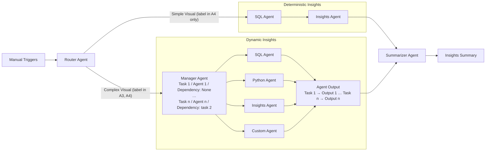
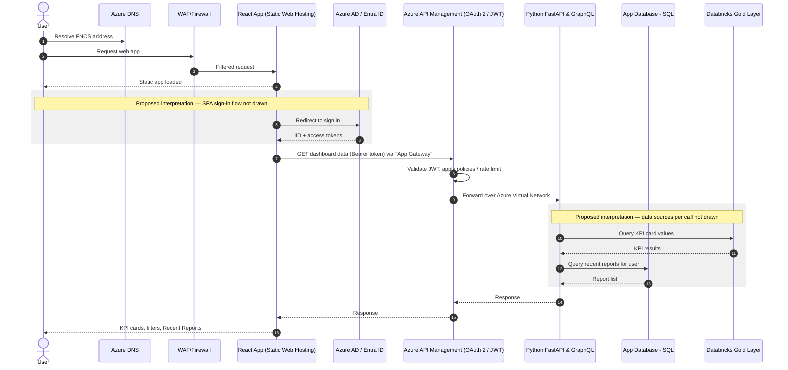
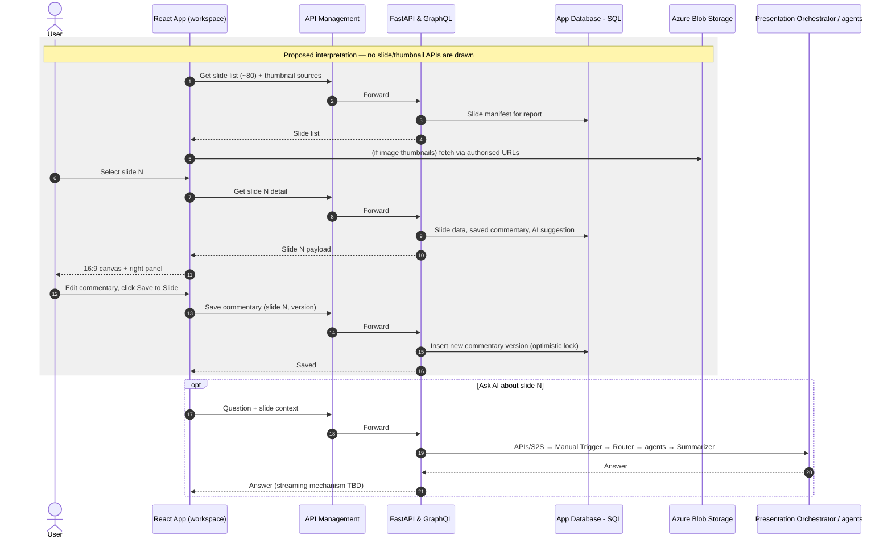
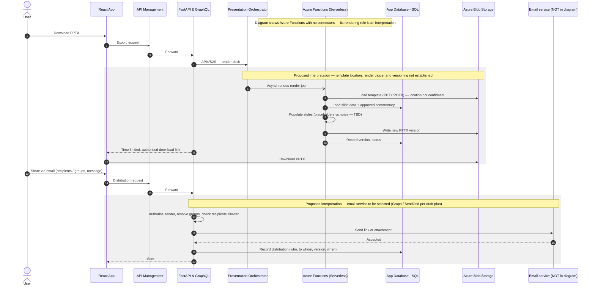

# FNOS Automation Engine — Architecture Deep Dive

| | |
|---|---|
| **Purpose** | Explain the signed-off solution architecture component by component, trace the confirmed user workflow through it, and list what remains to be designed before coding. |
| **Audience** | Developers joining FNOS, including those new to Azure. |
| **Status of the architecture** | **Approved.** This document explains it. It does not redesign or simplify it. |
| **Primary source** | `assets/architecture/architecture-1.png`, `architecture-2.png`, `architecture-3.png`, `architecture-4.png` (each about 1150 × 660 px). Every region was inspected at 2–3× magnification. |
| **Prepared** | 2026-10-09 |

> **Path note (2026-10-12):** the workspace was reorganised after this document was written. File paths in backticks were updated to the new locations (the frontend POC moved to `archive/frontend-poc/`); the content and findings were not changed. See the repository `README.md` for the current layout.


### How to read this document

Every statement carries one of these tags:

| Tag | Meaning |
|---|---|
| **[Diagram]** | Visible in the signed-off diagrams (filename cited where it matters). |
| **[Interpretation]** | A reasonable technical reading of what the diagram shows. It is **not** drawn explicitly. |
| **[Supporting]** | Stated in another workspace file. These files are exploratory or proof-of-concept and **are not approved requirements**. |
| **[Not established]** | Neither the diagrams nor the supporting files settle it. "Implementation detail not established." |
| **[Confirmed workflow]** | Part of the confirmed application workflow given by the project lead (§4 intro). |

### Supporting files referenced

| Ref | File | Status |
|---|---|---|
| SF-1 | `assets/ui-mockups/login.png`, `main_page.png`, `canvas.png`, `onclick_distribution.png` | UI mockups (exploratory) |
| SF-2 | `archive/frontend-poc/src/App.jsx` | Clickable React prototype, fully mocked (exploratory) |
| SF-3 | `plans/original/FNOS_App_Development_Plan.xlsx` (sheet *Webapp Plan*, row `rN`) | Draft plan (exploratory) |
| SF-4 | `archive/plan-scripts/generate_resequenced_plan.py`, `archive/plan-scripts/generate_plain_plan.py` | Scripts holding earlier plan versions (exploratory) |
| SF-5 | `archive/poc/poc_generate_80_slides.py` | python-pptx proof of concept (exploratory) |
| SF-6 | `templates/FNOS_Automation_Template_Design_Deck_Final.pptx` | Before/after report redesign catalogue (58 slides) |
| SF-7 | `plans/original/FNOS_Project_Plan_Initial_Draft.xlsx` (sheet *DS Team Plan*) | Draft Data Science plan (exploratory) |
| SF-8 | `docs/analysis/PROJECT_DISCOVERY_REPORT.md` | Earlier discovery report. Used only for cross-reference. |

---

## 1. Architecture Executive Overview

**In one paragraph.** FNOS is a secure, Azure-hosted web application. A Mars user signs in with corporate identity (Entra ID). A React single-page app sends requests through a protected API gateway (Azure API Management with OAuth 2 / JWT validation) into a Python backend running on Azure App Service. That backend has two cooperating parts:

- a **Presentation Orchestrator**;
- a **Python FastAPI & GraphQL** service.

The two talk to each other over "APIs/S2S" (service-to-service). The orchestrator triggers a **multi-agent AI subsystem**, asynchronously, to produce the insights behind the slides:

- a **Router Agent** chooses between a **deterministic** path (SQL Agent → Insights Agent) and a **dynamic** path;
- on the dynamic path, a **Manager Agent** plans tasks for SQL, Python, Insights and Custom agents;
- a **Summarizer Agent** then produces an **Insights Summary**.

The agents draw on presentation-ready data in a **Databricks** lakehouse (1CON/DDaS → Silver → Gold) and on **Azure AI Foundry** services (OpenAI GPT-4o, content safety filtering, Azure AI Search). Application state lives in an **App Database** (SQL + Azure Blob Storage). **Azure Functions** appear in the rendering area. The platform is monitored through Azure Monitor, App Insights and Log Analytics, and deployed from git through Azure Pipelines and Azure Container Registry.

### The four layers (as labelled in architecture-3 and architecture-4)

| Layer | Name in the diagram | Description in the diagram (verbatim) | Main components |
|---|---|---|---|
| 1 | Frontend Access & Security | "Secure Web portal for user authentication and managing access control to deck generation features." | Users, Azure DNS, React Application (Static Web Hosting), WAF/Firewall, Identity and Access Management (Azure AD / Entra ID, Key Vault, Policies) |
| 2 | API Gateway | "Gateway enforcing JWT/OAuth security, routing, and rate limits for frontend requests." | Azure API Management Gateway, OAuth 2 (JWT OAuth validation), Azure Virtual Network |
| 3 | Presentation Orchestrator | "Central logic for data retrieval, AI content generation, and slide assembly." | Azure App Services Presentation Orchestrator, Python FastAPI & GraphQL, multi-agent subsystem, Azure Functions (Serverless), App Services |
| 4 | Data Management & Storage | "Scalable data warehouse curating diverse sources into presentation-ready, quality tables." | Data Ingestion & Integration Pipelines: 1CON/DDaS, Silver Layer, Gold Layer; Databricks Workflow; ETL/ELT Orchestration |

**Cross-cutting blocks (outside the layers):**

| Block | Components |
|---|---|
| AI | Azure AI Foundry, OpenAI (GPT-4o), Content safety filtering, Azure AI Search |
| Observability and Monitoring | Azure Monitor, App Insights, Log Analytics, Monitor Dashboard |
| App Database | SQL, Azure Blob Storage |
| CI/CD | git → Azure Pipelines → Azure Container Registry |
| Foundational Platform (architecture-1 and -2 only) | Azure AD / Entra ID, Azure Container Registry, Azure Key Vault, Azure Monitor |

### Most important architectural facts for developers

1. **The backend has two named services** (Presentation Orchestrator and FastAPI & GraphQL) connected by "APIs/S2S". **[Diagram]** How work is split between them is **[Not established]**.
2. **Insight generation is asynchronous.** The arrow into the agent subsystem is labelled "Asynchronous slide rendering and handling". **[Diagram]**
3. **The agent design has two explicit paths.** The deterministic path is a fixed SQL → Insights pipeline. The dynamic path is task planning with dependencies. Both converge on one Summarizer. **[Diagram]**
4. **Azure Functions are drawn with no connecting arrow in any diagram.** Their role in rendering is inferred only from position next to the "asynchronous slide rendering" label. **[Diagram — absence]**
5. **The diagrams show no email service, job queue, cache, PPTX template store, thumbnail renderer or real-time progress channel.** These are implementation details still to be designed within the approved architecture. **[Diagram — absence]**

---

## 2. Detailed Diagram Comparison

### 2.1 Verdict

**The four diagrams contain the same set of components.** They differ in:

- **layout and layer order**;
- **labelling detail** (layer descriptions, agent names, routing labels);
- a small number of **connector endpoints**: which box an arrow terminates on.

**No component is added or removed between versions**, except that the "Foundational Platform" summary box appears only in architecture-1 and -2. That box repeats components shown elsewhere (Entra ID, Key Vault, Azure Monitor, Container Registry).

**Which version is authoritative cannot be established from the files.** The file timestamps (2026-10-06, 04:23:30 → 04:24:24, in numeric order) and the progressively richer labelling *suggest* that architecture-4 is the latest iteration. That is an inference, not evidence of precedence. **[Not established]** The architect should name the canonical version, or confirm that all four are equivalent.

### 2.2 Layout differences (cosmetic)

| Aspect | architecture-1 | architecture-2 | architecture-3 | architecture-4 |
|---|---|---|---|---|
| Orientation | Left → right | Left → right | Top → bottom | Top → bottom |
| Layer numbering | L1 = Data (left) … L4 = Frontend (right) | L1 = Frontend (left) … L4 = Data (right) | L1 = Frontend (top) … L4 = Data (bottom) | Same as -3 |
| Layer descriptions | None | None | Left-hand legend with one sentence per layer | Same as -3 |
| "Foundational Platform" box | Yes | Yes | No | No |
| Agent box names (dynamic path) | "SQL Agent", "Python", "Insights", "Custom" | Same as -1 | Same as -1 | "SQL Agent", "Python Agent", "Insights Agent", "Custom Agent" |
| Visual quality | Clear | Clear | Clear | Agent subsystem rendered in **faint yellow at low resolution**. Text is only partly legible; architecture-3 was used to confirm its contents. |

### 2.3 Connector-by-connector comparison

"→" means arrowhead at the destination; "↔" means arrowheads at both ends.

| # | Connector | architecture-1 | architecture-2 | architecture-3 | architecture-4 | Assessment |
|---|---|---|---|---|---|---|
| E1 | Azure DNS → React Application | DNS ↓ React | DNS ↓ React | DNS → React (text "Entra ID Authentication" under DNS) | Same as -3 | Same meaning |
| E2 | WAF/Firewall → React Application | WAF ↑ React | WAF ↑ React | WAF ← (points left into React) | Same as -3 | Same meaning: WAF protects the web app |
| E3 | Layer 1 → API Management, labelled "App Gateway" | Bracket joins the Frontend box **and** the IAM box → APIM | Same bracket → APIM | Arrow from the whole Layer-1 boundary → APIM | Same as -3 | Same meaning |
| E4 | APIM → Azure Virtual Network → Layer 3 | Ends at **Python FastAPI & GraphQL** | Ends at **Presentation Orchestrator** | Ends on the orchestrator group boundary, just left of FastAPI | Ends at **FastAPI & GraphQL** | **Endpoint differs.** Three of four point at FastAPI. Which service is the gateway's backend is **[Not established]**. |
| E5 | Presentation Orchestrator ↔ FastAPI, "APIs/S2S" | ↔ | ↔ | ↔ | ↔ | Identical |
| E6 | "Asynchronous slide rendering and handling" → agent subsystem | **↔** between Presentation Orchestrator and the agent subsystem | From FastAPI → agent subsystem | From the orchestrator/FastAPI group → agent subsystem | Same as -3 | **Direction differs.** Two-way only in architecture-1. |
| E7 | Manual Triggers → Router Agent | → | → | → | → | Identical |
| E8a | Router → Deterministic Insights (SQL Agent) | Unlabelled | Unlabelled | Unlabelled | Labelled **"Simple Visual"** | Routing criterion appears only in -4 |
| E8b | Router → Dynamic Insights (Manager Agent) | Unlabelled | Unlabelled | Labelled **"Complex Visual"** | Labelled **"Complex Visual"** | Routing criterion appears in -3 and -4 |
| E9 | SQL Agent → Insights Agent → Summarizer Agent | → | → | → | → | Identical |
| E10 | Manager Agent task list ("Task:1 / Agent: 1 / Dependency: None" … "Task:n / Agent:n / Dependency: task 2") | Shown | Shown | Shown, with a ↕ between task entries | Shown (faint) | Identical |
| E11 | Manager → {SQL, Python, Insights, Custom} → Agent Output ("Task: 1 Output: 1" … "Task: n Output: n") → Summarizer | → | → | → | → | Identical |
| E12 | Summarizer Agent → Insights Summary | → | → | → | → | Identical |
| E13 | Data layer → Layer 3 ("Databricks Workflow", "ETL/ELT Orchestration") | Data → agent subsystem (rightward) | Data → agent subsystem (leftward) | Data ↑ into Layer 3, below the agent subsystem | Same as -3 | Same meaning: data flows from the lakehouse into the orchestration layer |
| E14 | 1CON/DDaS → lakehouse | → "Unified Data Lake/Warehouse" | Same as -1 | → Silver Layer | → Silver Layer | Same meaning |
| E15 | Silver Layer → Gold Layer | **No arrow** | No arrow | No arrow | No arrow | Silver-to-Gold refinement is implied by naming, not drawn |
| E16 | AI services block → Layer 3 | Ends under FastAPI | Ends under Presentation Orchestrator | Ends at FastAPI | Ends at FastAPI | **Endpoint differs** (as E4) |
| E17 | Observability and Monitoring → Layer 3 | ↑ into Layer 3 boundary | ↑ into Layer 3 boundary | ← into Layer 3 boundary, labelled "Observability and Monitoring" | Same as -3 | Same meaning. The arrow points *from* monitoring *into* the apps. Telemetry normally flows apps → monitoring, so this is read as an association, not a data direction. **[Interpretation]** |
| E18 | App Database (SQL, Blob) → Layer 3 | → Layer 3 boundary beside App Services/Functions | → **App Services** | ← Layer 3 boundary, labelled "App Database" | ← Layer 3 boundary at App Services level, labelled "App Database" | Same meaning. One-directional arrow; real use is read and write. **[Interpretation]** |
| E19 | git → Azure Pipelines → Azure Container Registry; CI/CD → App Services | Shown | Shown | Shown | Shown | Identical |
| E20 | Azure Functions (Serverless) | **No connector** | **No connector** | **No connector** | **No connector** | Placement only |
| E21 | Small → at the top-right corner of the FastAPI box | — | — | Present; target unclear | — | **Unclear.** Possibly a leftover drawing artefact; not interpreted. |

### 2.4 Legibility notes and uncertainties

- "App Gateway" is a **label on an arrow**, not a component with an Azure icon. It may mean Azure Application Gateway (which can host a WAF), or simply "the path to the gateway". **[Not established]**
- "1CON/DDaS" is legible but not expanded anywhere in the workspace. **[Not established]**
- "Python Fast API &Graph QL" carries a spell-checker squiggle in all four images, which shows they were exported from an editing tool. This has no architectural meaning.
- The architecture-4 agent subsystem is faint. Its content was confirmed against architecture-3, which has the same structure. The faint labels in -4 ("Simple Visual", "Python Agent", "Insights Agent", "Custom Agent") were confirmed at 2× zoom.

---

## 3. Component-by-Component Explanation

### 3.1 Component inventory

The "Evidence" column lists the diagrams that show the component (A1–A4 = architecture-1 … -4).

| # | Component | Azure service / technology | Purpose | Inputs | Outputs | Connected components (drawn) | Evidence | Open questions |
|---|---|---|---|---|---|---|---|---|
| C1 | Users | — (Mars employees) | Use FNOS | — | Browser requests | Azure DNS (by position) | A1–A4 | Which user groups and roles? |
| C2 | Azure DNS | Azure DNS | Resolve the FNOS domain name | Domain name lookups | IP / host for the web app and API | React Application | A1–A4 | Domain names; public or private zone? |
| C3 | Entra ID Authentication (label) | Microsoft Entra ID | Corporate sign-in | User credentials (at Entra) | Tokens | Shown on the DNS → React path | A1–A4 | Sign-in flow type; token audiences |
| C4 | React Application — Static Web Hosting | React SPA on an Azure static hosting service | User interface | User actions; API responses | API requests; rendered UI | Azure DNS, WAF, Layer 2 ("App Gateway") | A1–A4 | Which hosting service? Routing; CSP |
| C5 | WAF/Firewall | Web Application Firewall (exact service not named) | Block malicious web traffic | Inbound HTTP(S) | Filtered traffic | React Application | A1–A4 | Which service (Front Door / App Gateway WAF)? Does it also protect the API? |
| C6 | Azure AD / Entra ID | Microsoft Entra ID | Identity provider | Sign-in requests; app registrations | Tokens; group claims | IAM group → "App Gateway" (A1/A2) | A1–A4 | App registrations; group-to-role mapping |
| C7 | Key Vault | Azure Key Vault | Store secrets, keys, certificates | Secrets written by operators or pipelines | Secrets to services | IAM group (no individual arrow) | A1–A4 | Which secrets? Managed identity access? |
| C8 | Policies | Not named (e.g. Azure Policy or access policies) | Governance and access rules | — | — | IAM group | A1–A4 | What "Policies" refers to |
| C9 | App Gateway (label) | Possibly Azure Application Gateway | Path from frontend to API gateway | Frontend API calls | Calls into APIM | Layer 1 → APIM | A1–A4 | Is it a separate Azure resource? |
| C10 | Azure API Management Gateway | Azure API Management | Single front door for APIs: policy routing, rate limiting | HTTPS API calls with bearer tokens | Routed calls to the backend | "App Gateway" in; Azure VNet out | A1–A4 | API products, policies, tier |
| C11 | OAuth 2 — JWT OAuth validation | OAuth 2.0 / JWT validation (APIM policy, per layer description) | Reject unauthenticated or invalid calls | Access token | Allow / deny; claims | Within the APIM box | A1–A4 | Required scopes and roles; is the token re-validated in the backend? |
| C12 | Azure Virtual Network | Azure VNet | Private network between gateway and backend | Gateway → backend traffic | Private connectivity | APIM → Layer 3 | A1–A4 | Subnets, private endpoints, VNet integration of each service |
| C13 | Azure App Services Presentation Orchestrator | Azure App Service | Coordinate report generation ("presentation orchestration") | Requests via S2S; agent results | Agent invocations; assembled report state | FastAPI (APIs/S2S); agent subsystem (async); APIM (A2) | A1–A4 | Exact responsibilities vs FastAPI; language/runtime |
| C14 | Python FastAPI & GraphQL | Python, FastAPI web framework, GraphQL API | Backend API implementation | API calls via APIM/VNet; AI services; S2S | JSON/GraphQL responses; S2S calls | APIM/VNet (A1/A3/A4); Orchestrator; AI services; agent subsystem (A2) | A1–A4 | Which operations are REST vs GraphQL? Hosting service? |
| C15 | APIs/S2S (connector) | Service-to-service API calls | Internal communication | — | — | Orchestrator ↔ FastAPI | A1–A4 | Protocol, authentication (managed identity?), contracts |
| C16 | Manual Triggers | — (concept) | Start an insight run on demand | A user/backend request | Trigger to Router | Router Agent | A1–A4 | What counts as a trigger? Are scheduled triggers ever needed? |
| C17 | Router Agent | AI agent (framework not named) | Choose the deterministic or dynamic path | Trigger + request context | Routed task | Deterministic path; Manager Agent | A1–A4 | Routing rules; is it LLM-based or rule-based? |
| C18 | Deterministic Insights — SQL Agent | AI agent | Retrieve data with SQL for the fixed path | Routed request | Query results | Insights Agent | A1–A4 | Is the SQL generated or pre-defined? |
| C19 | Deterministic Insights — Insights Agent | AI agent | Derive insights from retrieved data | Query results | Insight content | Summarizer Agent | A1–A4 | Output schema |
| C20 | Dynamic Insights — Manager Agent | AI agent (planner) | Break a complex request into tasks with dependencies | Routed complex request | Task plan (Task, Agent, Dependency) | SQL / Python / Insights / Custom agents | A1–A4 | Planning method; limits on number of tasks |
| C21 | Dynamic — SQL Agent | AI agent | Retrieve data for a task | Task | Data output | Agent Output | A1–A4 | Same as C18 |
| C22 | Dynamic — Python Agent | AI agent with Python execution | Calculations and transformations | Task + data | Computed output | Agent Output | A1–A4 | Sandbox; allowed libraries; execution host |
| C23 | Dynamic — Insights Agent | AI agent | Analyse task data | Task + data | Insight output | Agent Output | A1–A4 | Output schema |
| C24 | Dynamic — Custom Agent | AI agent (extensibility slot) | Specialised tasks | Task | Output | Agent Output | A1–A4 | What custom agents exist in v1? |
| C25 | Agent Output | Intermediate results store / collection | Collect per-task outputs | Agent outputs | Combined outputs | Summarizer Agent | A1–A4 | Where it lives (memory, DB); format |
| C26 | Summarizer Agent | AI agent | Merge results into the final insight narrative | Deterministic or dynamic outputs | Insights Summary | Insights Summary | A1–A4 | Narrative format per slide |
| C27 | Insights Summary | Output artefact | Final AI content for slides | Summarizer output | Content to the presentation | — (end node) | A1–A4 | How it is mapped to slides and stored |
| C28 | Simple Visual / Complex Visual (labels) | — | Routing criteria | — | — | Router branches | A4 (both); A3 (Complex only) | Exact definitions |
| C29 | Asynchronous slide rendering and handling (connector) | Async processing | Decouple long-running generation from requests | Orchestrator requests | Agent work started | Orchestrator/FastAPI → agents | A1–A4 | Mechanism (queue, background task, Functions) |
| C30 | Azure Functions (Serverless) | Azure Functions | Serverless compute in the rendering area | **Not drawn** | **Not drawn** | **None drawn** | A1–A4 | Exact job: rendering? triggers? |
| C31 | App Services (standalone icon) | Azure App Service | Hosting target for deployed containers | Container images from ACR | Running app instances | CI/CD → App Services; App DB → App Services (A2) | A1–A4 | Which apps it hosts; plan/SKU |
| C32 | 1CON/DDaS | Upstream enterprise data source(s) | Source business data | Source systems | Raw data to ingestion | → Silver / Unified Data Lake | A1–A4 | Meaning, owners, refresh |
| C33 | Data Ingestion & Integration Pipelines | Databricks pipelines (implied by the box) | Move and transform source data | Raw data | Silver/Gold tables | 1CON/DDaS, Silver, Gold | A3, A4 (box title) | Pipeline ownership |
| C34 | Unified Data Lake / Warehouse | Databricks lakehouse (implied) | Central analytical store | Ingested data | Curated tables | Silver, Gold | A1–A4 | Catalog/schema names |
| C35 | Silver Layer (Pre Processed Data) | Lakehouse tables | Cleaned, conformed data | Raw data | Pre-processed tables | (Gold — not drawn) | A1–A4 | — |
| C36 | Gold Layer (Presentation Data) | Lakehouse tables | Presentation-ready KPIs | Silver data | Tables consumed by FNOS | → Layer 3 via Databricks Workflow / ETL | A1–A4 | **Data contract**; access method; latency |
| C37 | Databricks Workflow / ETL/ELT Orchestration | Azure Databricks Workflows | Schedule and run the data pipelines | Pipeline definitions | Refreshed tables | Data layer → Layer 3 | A1–A4 | Schedule; does it notify FNOS? |
| C38 | Azure AI Foundry | Azure AI Foundry | Platform hosting the AI services | — | AI endpoints | → Layer 3 | A1–A4 | Project/hub setup; region |
| C39 | OpenAI (GPT-4o) | Azure OpenAI model deployment | Language generation for agents | Prompts + context | Text / structured output | (inside AI block) | A1–A4 | Deployment region, quota, model version |
| C40 | Content safety filtering | Azure AI Content Safety / built-in filters | Filter harmful inputs and outputs | Prompts, completions | Allow / block signals | (inside AI block) | A1–A4 | Thresholds; custom blocklists |
| C41 | Azure AI Search | Azure AI Search | Retrieval index (knowledge grounding) | Documents / indexed content | Search results | (inside AI block) | A1–A4 | **What is indexed?** |
| C42 | Azure Monitor | Azure Monitor | Platform metrics and alerts | Telemetry | Alerts, metrics | → Layer 3 | A1–A4 | Alert rules |
| C43 | App Insights | Application Insights | Application telemetry (requests, traces, errors) | App telemetry | Traces, dashboards | → Layer 3 | A1–A4 | Correlation across agents |
| C44 | Log Analytics | Log Analytics workspace | Central log store and query | Logs | Queries, workbooks | → Layer 3 | A1–A4 | Retention; what is logged (PII, prompts?) |
| C45 | Monitor Dashboard | Azure dashboards / workbooks | Operational visibility | Metrics/logs | Dashboards | (inside block) | A1–A4 | Content |
| C46 | SQL (App Database) | SQL database (icon labelled "SQL"; SF-3 r13 names Azure SQL) | Application data | Reads/writes from Layer 3 | Stored records | → Layer 3 / App Services | A1–A4 | Schema; ownership |
| C47 | Azure Blob Storage (App Database) | Azure Blob Storage | Files (e.g. PPTX) | File writes | Files / download URLs | → Layer 3 / App Services | A1–A4 | Containers, retention, access model |
| C48 | git | Git repository | Source code | Commits | Triggers pipelines | → Azure Pipelines | A1–A4 | Repo location (Azure Repos / GitHub?) |
| C49 | Azure Pipelines | Azure DevOps Pipelines | Build, test, deploy | Code | Container images; deployments | git → Pipelines → ACR; → App Services | A1–A4 | Stages, environments, approvals |
| C50 | Azure Container Registry | ACR | Store container images | Images from Pipelines | Images to App Services | Pipelines; App Services | A1–A4 | Which services are containerised? |
| C51 | Foundational Platform (box) | Summary of shared services | Show shared platform services | — | — | None | A1, A2 | — (duplicate listing) |

### 3.2 Layer 1 — Frontend Access & Security

**C1 Users** [Diagram]
- *What:* The people who use FNOS.
- *Why needed:* They generate, review, edit and distribute reports.
- *Responsibility:* Initiate every workflow.
- *Receives:* The UI.
- *Outputs:* Clicks, filter selections, commentary text, questions to AI.
- *Talks to:* Shown beside Azure DNS; no arrow of its own.
- *Mechanism shown:* None.
- *Unspecified:* User roles, permitted actions and user groups. **[Not established]**

**C2 Azure DNS** [Diagram]
- *What:* Azure's Domain Name System hosting. It turns a name such as `fnos.<domain>` into an address.
- *Why needed:* Users reach FNOS by name, not by IP address.
- *Responsibility:* Name resolution for the web app (and probably the API). **[Interpretation]**
- *Receives:* DNS queries.
- *Outputs:* Addresses.
- *Talks to:* An arrow points to the React Application (all four).
- *Mechanism shown:* DNS resolution (implied by the service).
- *Unspecified:* Domain names, and whether the zone is public or private. **[Not established]**

**C3 "Entra ID Authentication" (label under Azure DNS)** [Diagram]
- *What:* A text label stating that users authenticate with Microsoft Entra ID (formerly Azure AD).
- *Why needed:* Only Mars employees may use FNOS.
- *Responsibility:* Marks the entry path as authenticated.
- *Receives / Outputs:* Not drawn. Conventionally the browser sends credentials to Entra ID and receives tokens. **[Interpretation]**
- *Talks to:* Not drawn separately.
- *Mechanism shown:* None beyond the label.
- *Unspecified:* Flow type (e.g. OAuth 2.0 authorisation-code flow with PKCE for a single-page app), token lifetimes, conditional access. **[Not established]**

**C4 React Application — Static Web Hosting** [Diagram]
- *What:* The browser application, built with React. "Static web hosting" means the compiled HTML/JS/CSS files are served as static files; all dynamic behaviour comes from API calls.
- *Why needed:* It is the dashboard, slide workspace and distribution UI.
- *Responsibility:* Render screens, manage UI state, obtain the user's token, and call the backend APIs.
- *Receives:* Static assets from hosting; API responses.
- *Outputs:* API requests (towards "App Gateway" → APIM).
- *Talks to:* Azure DNS (in), WAF/Firewall (in), Layer 2 via "App Gateway" (out).
- *Mechanism shown:* Arrows only. HTTPS is standard but not drawn. **[Interpretation]**
- *Unspecified:* Which Azure hosting service (e.g. Azure Static Web Apps or Storage static website), the frontend framework details, and the state-management approach. **[Not established]**

**C5 WAF/Firewall** [Diagram]
- *What:* A Web Application Firewall inspects HTTP traffic and blocks attacks such as SQL injection or cross-site scripting.
- *Why needed:* FNOS exposes confidential financial reporting over the web.
- *Responsibility:* Protect the web entry point.
- *Receives:* Inbound web traffic.
- *Outputs:* Filtered traffic.
- *Talks to:* Arrow to the React Application (all four).
- *Mechanism shown:* Arrow only.
- *Unspecified:* Which Azure service provides it (Front Door WAF or Application Gateway WAF), whether API traffic also passes through it, and the rule sets. **[Not established]**

**C6 Azure AD / Entra ID** [Diagram]
- *What:* Microsoft's identity service for Mars accounts.
- *Why needed:* Single sign-on and group membership.
- *Responsibility:* Authenticate users, issue tokens, provide group or role claims. **[Interpretation]**
- *Receives:* Sign-in requests.
- *Outputs:* ID and access tokens.
- *Talks to:* In A1/A2 the whole IAM box feeds the "App Gateway" bracket into APIM. This signals that APIM relies on Entra-issued tokens. **[Interpretation]**
- *Mechanism shown:* OAuth 2 / JWT (named in Layer 2).
- *Unspecified:* App registrations (one for the SPA, one for the API?), scopes, app roles, group mapping. **[Not established]**

**C7 Key Vault** [Diagram]
- *What:* Secure storage for secrets such as connection strings, API keys and certificates.
- *Why needed:* Credentials for Databricks, SQL, AI services and email must not live in code.
- *Responsibility:* Hold secrets, keys and certificates.
- *Receives:* Secrets from administrators or pipelines.
- *Outputs:* Secrets to authorised services.
- *Talks to:* No individual arrow; it sits inside the IAM group.
- *Mechanism shown:* None.
- *Unspecified:* Which secrets, and whether services use managed identities to read them. **[Not established]**

**C8 Policies** [Diagram]
- *What:* A box labelled "Policies" in the IAM group.
- *Why needed / responsibility:* Likely governance or access policies. It could mean Azure Policy, Entra Conditional Access, or APIM policies. **[Interpretation]**
- *Inputs, outputs, connections, mechanism:* Not drawn.
- *Unspecified:* Exactly what "Policies" refers to. **[Not established]**

### 3.3 Layer 2 — API Gateway

**C9 "App Gateway" (arrow label)** [Diagram]
- *What:* The labelled arrow from Layer 1 into Azure API Management.
- *Why needed:* Every frontend API call must go through the gateway.
- *Responsibility:* Represents the frontend → API path.
- *Receives / Outputs:* Frontend API traffic, passed on to APIM.
- *Talks to:* Layer 1 (from), APIM (to).
- *Mechanism shown:* Arrow.
- *Unspecified:* Whether "App Gateway" is an actual Azure Application Gateway resource. No Application Gateway icon is drawn. **[Not established]**

**C10 Azure API Management Gateway** [Diagram]
- *What:* A managed API gateway. It sits in front of backend APIs and applies cross-cutting rules.
- *Why needed:* It centralises security, routing and throttling for all frontend calls ("Policy Routing, Rate Limiting").
- *Responsibility:* Route requests to the backend, enforce rate limits, and run security policies.
- *Receives:* API requests from the React app.
- *Outputs:* Forwarded requests to Layer 3 over the Azure Virtual Network.
- *Talks to:* "App Gateway" (in). The VNet arrow (out) ends at FastAPI in A1/A4, near FastAPI in A3, and at the Presentation Orchestrator in A2.
- *Mechanism shown:* "Policy Routing, Rate Limiting".
- *Unspecified:* API definitions, versioning, rate-limit values, APIM tier, whether streaming responses are passed through. **[Not established]**

**C11 OAuth 2 — "JWT OAuth validation"** [Diagram]
- *What:* Validation of OAuth 2.0 access tokens in JWT (JSON Web Token) format.
- *Why needed:* It ensures each API call comes from a signed-in, authorised user.
- *Responsibility:* Check signature, issuer, audience and expiry. The Layer 2 description says "enforcing JWT/OAuth security".
- *Receives:* Bearer tokens.
- *Outputs:* Accept or reject; validated claims.
- *Talks to:* Part of the APIM box.
- *Mechanism shown:* OAuth 2 / JWT.
- *Unspecified:* Required scopes or roles per API; whether the backend validates the token again (defence in depth); how user identity propagates to backend services. **[Not established]**

**C12 Azure Virtual Network** [Diagram]
- *What:* A private network in Azure.
- *Why needed:* It keeps gateway-to-backend traffic off the public internet.
- *Responsibility:* Private connectivity for Layer 3.
- *Receives / Outputs:* Gateway traffic, delivered to the backend.
- *Talks to:* APIM → Layer 3.
- *Mechanism shown:* Network label with an icon.
- *Unspecified:* Subnets, private endpoints for SQL, Blob, Databricks and AI services, and App Service VNet integration. **[Not established]**

### 3.4 Layer 3 — Presentation Orchestrator

**C13 Azure App Services — Presentation Orchestrator** [Diagram]
- *What:* An application hosted on Azure App Service (a managed web-app hosting platform), named "Presentation Orchestrator".
- *Why needed:* Producing a report involves several steps (data, AI insights, slide assembly) that must be coordinated.
- *Responsibility:* Coordinate the generation of presentation content, consistent with the Layer 3 description "Central logic for data retrieval, AI content generation, and slide assembly". **[Interpretation]**
- *Receives:* Service-to-service calls from FastAPI ("APIs/S2S"); in A2, gateway traffic directly; results from the agent subsystem (two-way arrow in A1).
- *Outputs:* Asynchronous requests to the agent subsystem; results back to FastAPI.
- *Talks to:* FastAPI (↔), agent subsystem (async), APIM (A2 only).
- *Mechanism shown:* "APIs/S2S"; "Asynchronous slide rendering and handling".
- *Unspecified:* Its exact boundary with FastAPI, its programming language, how it tracks job state, and whether the agents run inside it. **[Not established]**

**C14 Python FastAPI & GraphQL** [Diagram]
- *What:* A Python web service built with FastAPI (a Python framework for HTTP APIs) that also exposes GraphQL (a query language that lets clients ask for exactly the fields they need).
- *Why needed:* It is the programmable API behind the UI and between services.
- *Responsibility:* Expose API operations and call the Orchestrator and AI services. **[Interpretation]**
- *Receives:* Gateway traffic over the VNet (A1/A3/A4); S2S calls from the Orchestrator; AI services responses.
- *Outputs:* API responses; S2S calls; in A2, the asynchronous call into the agent subsystem.
- *Talks to:* APIM/VNet, Presentation Orchestrator, AI services block, agent subsystem (A2).
- *Mechanism shown:* "APIs/S2S".
- *Unspecified:* Which operations are REST and which GraphQL; the hosting service (it sits in the same group as the App Service, but no icon of its own); authentication between services. **[Not established]**

**C15 "APIs/S2S"** [Diagram]
- *What:* A two-way service-to-service API link between Orchestrator and FastAPI.
- *Why needed:* The two backend parts must exchange requests and results.
- *Responsibility, inputs and outputs:* Carry requests and results in both directions.
- *Mechanism shown:* "APIs".
- *Unspecified:* Protocol (HTTP/REST, GraphQL, gRPC), service authentication (e.g. managed identity tokens), contracts. **[Not established]**

**C16 Manual Triggers** [Diagram]
- *What:* The entry point into the agent subsystem.
- *Why needed:* Insight runs start when a user acts, e.g. "Generate Narrative" or "Ask AI". **[Interpretation]**
- *Responsibility:* Start a run.
- *Receives:* A request from the Orchestrator path. **[Interpretation]**
- *Outputs:* A trigger to the Router Agent.
- *Talks to:* Router Agent.
- *Mechanism shown:* Arrow.
- *Unspecified:* Which user actions count as triggers. No scheduled trigger is drawn. **[Not established]**

**C17–C27 Agent subsystem components.** See §8 for the full explanation of each agent, including all eight questions.

**C29 "Asynchronous slide rendering and handling" (connector label)** [Diagram]
- *What:* A label on the arrow from the Orchestrator/FastAPI group into the agent subsystem. In A1 the arrow is two-way, between the Orchestrator and the agent subsystem.
- *Why needed:* Generating content for ~80 slides takes too long for a single blocking web request. **[Interpretation]**
- *Responsibility:* Run generation in the background while the caller continues.
- *Receives / Outputs:* Requests; results ("handling").
- *Mechanism shown:* "Asynchronous".
- *Unspecified:* The mechanism (message queue, background worker, Durable Functions), how progress is reported, retries. **[Not established]**

**C30 Azure Functions (Serverless)** [Diagram]
- *What:* Azure's serverless compute. Code runs on demand in response to triggers, without managing servers.
- *Why needed:* It is drawn next to "Asynchronous slide rendering and handling", which suggests it performs background or rendering work. **[Interpretation]** SF-3 r28 plans "Serverless Worker to Populate and Generate Full 80-Slide PowerPoint Deck (Azure function)". **[Supporting]**
- *Responsibility:* **[Not established]** by the diagram.
- *Receives / Outputs:* **Not drawn.**
- *Talks to:* **No connector in any of the four diagrams.**
- *Unspecified:* Its trigger type, what it renders (insights? PPTX?), and how it reads templates and writes output. **[Not established]**

**C31 App Services (standalone icon)** [Diagram]
- *What:* A second App Service icon. It is separate from the Presentation Orchestrator.
- *Why needed:* It is the deployment target for container images built by CI/CD. **[Interpretation]**
- *Responsibility:* Host the backend applications. **[Interpretation]**
- *Receives:* Deployments from the CI/CD group (all four); App Database arrow (A2).
- *Outputs:* Running services.
- *Talks to:* CI/CD, App Database.
- *Mechanism shown:* Arrows.
- *Unspecified:* Whether it is the App Service Plan hosting the Orchestrator and FastAPI, or a separate application. **[Not established]**

### 3.5 Layer 4 — Data Management & Storage

**C32 1CON/DDaS** [Diagram]
- *What:* The upstream source of enterprise data. The acronyms are not expanded anywhere in the workspace.
- *Why needed:* It is the origin of the financial and market data shown in reports.
- *Responsibility:* Supply raw data.
- *Receives:* Not drawn.
- *Outputs:* Data into Silver (A3/A4) or into the Unified Data Lake (A1/A2).
- *Mechanism shown:* Arrow inside "Data Ingestion & Integration Pipelines" (A3/A4).
- *Unspecified:* Meaning, owners, refresh frequency. **[Not established]**

**C33 Data Ingestion & Integration Pipelines** [Diagram, A3/A4 box title]
- *What:* The pipelines that bring source data into the lakehouse.
- *Why needed / responsibility:* Ingest and transform.
- *Inputs / Outputs:* From 1CON/DDaS into Silver and Gold tables.
- *Unspecified:* Ownership. The DS team plans pipelines in SF-7 **[Supporting]**.

**C34 Unified Data Lake / Warehouse** [Diagram]
- *What:* A "lakehouse": a data lake with warehouse-style tables. With Databricks this is typically Delta tables. **[Interpretation]**
- *Responsibility:* Central analytical storage.
- *Unspecified:* Catalog and schema names, Unity Catalog permissions. **[Not established]**

**C35 Silver Layer (Pre Processed Data)** [Diagram]
- *What:* The cleaned, conformed tier of a "medallion" design (Bronze → Silver → Gold). No Bronze tier is drawn.
- *Responsibility:* Hold standardised data.
- *Output:* Feeds Gold. Implied by naming; **no arrow drawn**.
- *Unspecified:* Table design. **[Not established]**

**C36 Gold Layer (Presentation Data)** [Diagram]
- *What:* The business-ready tier, labelled "Presentation Data".
- *Why needed:* FNOS reports read pre-calculated, validated KPIs, so the app does not compute them from raw data.
- *Responsibility:* Serve presentation-ready tables.
- *Outputs:* Data to Layer 3 via "Databricks Workflow" / "ETL/ELT Orchestration".
- *Talks to:* Layer 3 (in A1/A2 the arrow lands on the agent subsystem).
- *Unspecified:* The **data contract** (tables, columns, grain, KPI definitions); how agents query it (Databricks SQL Warehouse, connector, API); expected latency. **[Not established]**

**C37 Databricks Workflow / ETL/ELT Orchestration** [Diagram]
- *What:* Azure Databricks Workflows, the job scheduler that runs ETL/ELT pipelines (extract, transform, load).
- *Why needed:* Gold tables must be refreshed on a schedule.
- *Responsibility:* Run and orchestrate pipelines.
- *Outputs:* Refreshed tables. The arrow into Layer 3 indicates the data made available to the orchestrator and agents.
- *Mechanism shown:* Arrow labelled "Databricks Workflow" and "ETL/ELT Orchestration".
- *Unspecified:* Whether FNOS is notified when data refreshes; whether the arrow means "agents query Gold" or "the workflow pushes data". **[Not established]**

### 3.6 Cross-cutting: AI services

**C38 Azure AI Foundry** [Diagram]
- *What:* Microsoft's platform for building and hosting AI applications and model deployments.
- *Why needed:* It hosts the language model and related AI services used by the agents.
- *Responsibility:* Provide AI endpoints and management.
- *Talks to:* An arrow into Layer 3. It ends at FastAPI in A1/A3/A4 and under the Orchestrator in A2.
- *Unspecified:* Hub/project set-up, region, network isolation. **[Not established]**

**C39 OpenAI (GPT-4o)** [Diagram]
- *What:* A large language model deployed through Azure OpenAI.
- *Why needed:* Agents need natural-language reasoning and generation for narrative and routing.
- *Receives:* Prompts with data context.
- *Outputs:* Generated text or structured output.
- *Unspecified:* Which agents call it; deployment region; quota; model-version lifecycle (confirm the version stays available for the project's lifetime). **[Not established]**

**C40 Content safety filtering** [Diagram]
- *What:* Filters that detect harmful or policy-violating prompts and outputs.
- *Why needed:* Enterprise AI governance.
- *Unspecified:* Thresholds; whether custom filters (e.g. confidential terms) apply. **[Not established]**

**C41 Azure AI Search** [Diagram]
- *What:* A search and vector index service, commonly used for "retrieval-augmented generation" (RAG). The model is given relevant documents to ground its answers.
- *Why needed:* Agents can ground narrative in reference content.
- *Unspecified:* **What is indexed** (KPI definitions, prior commentary, glossary, product reviews?). SF-7 plans "Knowledge Base Creation / Integration" **[Supporting]**. **[Not established]**

### 3.7 Cross-cutting: App Database

**C46 SQL** [Diagram]
- *What:* A relational database. The icon is labelled "SQL"; the plan names Azure SQL (SF-3 r13) **[Supporting]**.
- *Why needed:* Application records such as reports, slides, commentary and job status. **[Interpretation]**
- *Talks to:* An arrow into Layer 3 (into App Services in A2).
- *Unspecified:* Schema, ownership, and whether "DS-provided tables" (SF-3 r13, r22 **[Supporting]**) means the DS team owns it. **[Not established]**

**C47 Azure Blob Storage** [Diagram]
- *What:* Object storage for files.
- *Why needed:* PowerPoint files and possibly the template. **[Interpretation]** The plan includes "Generate Secure Temporary Download Links to Export PowerPoint Files from Azure Storage" (SF-3 r31) **[Supporting]**.
- *Unspecified:* Container layout, what is stored (template? drafts? finals? thumbnails?), retention, access method. **[Not established]**

### 3.8 Cross-cutting: Observability

| Component | What it is | FNOS use | Unspecified |
|---|---|---|---|
| **C42 Azure Monitor** | Azure's platform for metrics, logs and alerts | Health and alerts for all services | Alert rules, SLOs |
| **C43 App Insights** | Application Performance Monitoring: requests, dependencies, exceptions, traces | Trace a generation request through FastAPI → Orchestrator → agents → Databricks / OpenAI | Correlation-ID strategy across asynchronous work |
| **C44 Log Analytics** | Workspace that stores and queries logs | Central log search | Retention; whether prompts or financial data may be logged |
| **C45 Monitor Dashboard** | Visual dashboards | Operations view | Content |

All four diagrams show one arrow from this block into Layer 3; it has no protocol. **[Diagram]**

### 3.9 Cross-cutting: CI/CD

| Component | What it is | FNOS use | Unspecified |
|---|---|---|---|
| **C48 git** | Version control | Source of truth for code | Repository host |
| **C49 Azure Pipelines** | Azure DevOps build and release pipelines | Build, test, package | Stages, environments, approvals, IaC |
| **C50 Azure Container Registry** | Private container image registry | Store backend images | Which components are containerised |
| Arrow → **C31 App Services** | Deployment | App Services runs images from ACR **[Interpretation]** | Deployment of the React app and the Functions is **not drawn** |

---

## 4. Complete User Journey Through the Architecture

**[Confirmed workflow]**

1. Corporate login.
2. Dashboard with KPI cards, Region / Market / Template filters, and Recent Reports.
3. "Generate Narrative".
4. PowerPoint-like workspace.
5. ~80 slide thumbnails in the left sidebar.
6. A 16:9 canvas in the centre.
7. A right panel with commentary, editing and Ask AI.
8. "Save to Slide".
9. Navigate and repeat.
10. Download the updated PPTX, or share it by email with authorised people or groups.

Each workflow below uses the same structure. "Established" lists only what the diagrams show.

### A. User login and Entra ID authentication

| Aspect | Detail |
|---|---|
| Frontend | Load the React app; redirect the user to Entra ID; receive tokens; keep the session; attach the access token to API calls. **[Interpretation]** |
| Backend | Trust tokens validated at APIM (C11); optionally re-validate and read user claims. **[Interpretation]** |
| Data/AI | None |
| Azure services | Azure DNS, WAF/Firewall, React static hosting, Entra ID, APIM (OAuth 2 / JWT) |
| Sequence | Browser resolves the name (DNS) → web traffic passes the WAF → React app loads → user authenticates with Entra ID → the app holds tokens → the first API call carries the token → APIM validates the JWT |
| Established | DNS, Entra ID authentication, React static hosting, WAF, APIM with JWT/OAuth validation **[Diagram]** |
| Decision needed | SPA sign-in library and flow; app registrations and scopes; role and group claims; session timeout; whether the backend re-checks tokens |

### B. Dashboard loading — KPI cards and recent reports

| Aspect | Detail |
|---|---|
| Frontend | Request KPI summaries and the user's recent reports; render cards. The KPI tabs in the mockups (CMI / Finance / Brand Category) are **[Supporting]** only. |
| Backend | Serve KPI values (from Gold) and the recent-report list (from the App Database). **[Interpretation]** |
| Data/AI | Gold-layer read for KPI cards |
| Azure services | APIM → VNet → FastAPI (± Orchestrator) → Databricks Gold; SQL |
| Sequence | React → APIM → FastAPI → (Gold query for KPIs) + (SQL query for recent reports) → response → render |
| Established | Gateway path; Gold layer as presentation data; App Database **[Diagram]** |
| Decision needed | Whether KPI cards query Databricks directly, or a cached/replicated copy; the API shape (REST or GraphQL); how "recent" is defined (per user? per team?); status values (Draft/Published appear in SF-1 **[Supporting]**) |

### C. Filter selection and validation

| Aspect | Detail |
|---|---|
| Frontend | Load the allowed values for Region, Market and Template; enforce dependent options (e.g. markets within a region); client-side validation |
| Backend | Provide option lists; **re-validate server-side**, including authorisation (may this user generate for this market?) |
| Data/AI | Option lists likely derive from Gold dimensions and from a template catalogue. **[Interpretation]** |
| Azure services | APIM → FastAPI → Gold / SQL |
| Established | Only the gateway and backend path **[Diagram]** |
| Decision needed | The source of truth for the template list; dependency rules; per-user restrictions; reporting-period selection (not in the confirmed workflow — confirm whether period is implied by the template or chosen) |

### D. Clicking "Generate Narrative"

| Aspect | Detail |
|---|---|
| Frontend | Send a generation request with the filters; show progress; open the workspace when ready (or progressively) |
| Backend | Create a report/job record; start **asynchronous** generation through the Orchestrator; return a job/report ID immediately **[Interpretation]** |
| Data/AI | Triggers the agent subsystem (Manual Triggers → Router) |
| Azure services | APIM → FastAPI ↔ Orchestrator → (async) agent subsystem; SQL for job state |
| Sequence | React → APIM → FastAPI → S2S → Orchestrator → async start → 202-style response with ID **[Interpretation]** → client follows progress |
| Established | Async processing ("Asynchronous slide rendering and handling") and the Manual Triggers entry **[Diagram]** |
| Decision needed | The async mechanism (queue, worker, Durable Functions); how the UI learns progress (polling, Server-Sent Events, WebSockets — SF-3 r19 mentions SSE **[Supporting]**; nothing is drawn); idempotency if the user clicks twice; cancellation; partial results |

### E. Retrieving data from Databricks and related sources

| Aspect | Detail |
|---|---|
| Frontend | None |
| Backend | Provide the agents with the request context (filters, template, slide definitions) |
| Data/AI | SQL Agents (deterministic and dynamic) query Gold tables; the Python Agent may compute derived figures |
| Azure services | Databricks (Gold), agent subsystem, possibly Azure AI Search for reference context |
| Sequence | Router → SQL Agent → Gold → results → Insights Agent (deterministic) / Agent Output (dynamic) |
| Established | Gold layer → Layer 3 (arrow); SQL Agents exist in both paths **[Diagram]** |
| Decision needed | Access method and identity (service principal or managed identity); **whether SQL is pre-defined per slide or generated by the LLM**; the Gold data contract; timeouts and caching; handling of missing data |

### F. Loading or generating the ~80-slide presentation

| Aspect | Detail |
|---|---|
| Frontend | Display the deck structure once available |
| Backend | Determine which slides belong to the chosen template; bind each slide to its data and generated insights; produce viewable slide content and (eventually) a PPTX |
| Data/AI | Insights Summary per slide (or per deck — see §8) |
| Azure services | Orchestrator; Azure Functions (by position only); Blob Storage; SQL |
| Established | Layer 3 is responsible for "slide assembly" (layer description) **[Diagram]** |
| Decision needed | See §9 in full. Template storage, the slide definition model, the rendering component, the preview format, and the 80-slide count are **[Not established]**. |

### G. Running the AI orchestration flow

| Aspect | Detail |
|---|---|
| Frontend | Show progress |
| Backend | The Orchestrator invokes the agent subsystem and collects the Insights Summary |
| Data/AI | Router → deterministic or dynamic path → Summarizer → Insights Summary; calls GPT-4o; content safety; optional AI Search |
| Azure services | Agent subsystem, Azure AI Foundry (GPT-4o, Content Safety, AI Search), Databricks Gold |
| Established | The full agent graph, AI services, async invocation **[Diagram]** |
| Decision needed | Agent framework and hosting; granularity (one run per deck, per slide, or per section?); output schema; numeric-accuracy validation (§8.6) |

### H. Opening the workspace and loading slide thumbnails

| Aspect | Detail |
|---|---|
| Frontend | Render the three-pane workspace: thumbnails (left), 16:9 canvas (centre), commentary/AI panel (right) **[Confirmed workflow]**. Load thumbnails lazily for ~80 slides. **[Interpretation]** |
| Backend | Provide the slide list and thumbnail sources |
| Azure services | APIM → FastAPI; Blob (if thumbnails are images) **[Interpretation]** |
| Established | Nothing specific to thumbnails is drawn |
| Decision needed | **How thumbnails are produced**: browser-rendered from slide data, or server-rendered images of PPTX slides. A PPTX-to-image converter is not in the diagram. See §9. |

### I. Navigating between slides

| Aspect | Detail |
|---|---|
| Frontend | Switch the active slide; fetch slide detail on demand; cache visited slides; protect unsaved edits **[Interpretation]** |
| Backend | Serve the slide detail (data payload, current commentary, AI suggestions) |
| Azure services | APIM → FastAPI → SQL (/Blob) |
| Established | Gateway and backend path only |
| Decision needed | Payload per slide; caching (SF-3 r17 **[Supporting]**; no cache component is drawn); what happens to unsaved edits on navigation |

### J. Loading slide-specific commentary and AI suggestions

| Aspect | Detail |
|---|---|
| Frontend | Show the commentary editor with the current saved text and the AI suggestions for the selected slide |
| Backend | Return the latest saved commentary plus the AI-generated content (Insights Summary) mapped to that slide |
| Data/AI | Already produced in G; possibly regenerated on demand |
| Established | The Insights Summary exists as the agent output **[Diagram]** |
| Decision needed | Commentary structure per slide (free text or named blocks — SF-2/SF-6 show Headline / So What / Now What **[Supporting]**); how AI suggestions are stored separately from human-approved text |

### K. Editing commentary and clicking "Save to Slide"

| Aspect | Detail |
|---|---|
| Frontend | Edit text; on "Save to Slide", send the slide ID, block content and a version/ETag; show confirmation |
| Backend | Authorise, validate, persist a new commentary version, and mark the deck as changed (needing re-render) **[Interpretation]** |
| Azure services | APIM → FastAPI → SQL |
| Established | App Database **[Diagram]** |
| Decision needed | Data model and versioning; concurrent edits by two users; text limits per slide placeholder; rich text vs plain text; audit |

### L. Persisting edits and reflecting them in the final PowerPoint

| Aspect | Detail |
|---|---|
| Frontend | Optionally show "PPTX out of date / regenerating" |
| Backend | Either re-render the affected slide(s) on save, or apply all saved commentary when the final PPTX is produced |
| Azure services | SQL (commentary), Blob (PPTX), Orchestrator / Azure Functions (rendering — by position only) |
| Established | Async "slide rendering and handling" exists **[Diagram]** |
| Decision needed | **When** the PPTX is regenerated (per save or on export); **where** commentary goes in the PPTX (a slide text placeholder vs speaker notes — see §9.3); whether the browser canvas and the PPTX are rendered from the same slide model |

### M. Asking AI questions about the selected slide

| Aspect | Detail |
|---|---|
| Frontend | Send the question with the slide/report context; display the answer (streamed or not) |
| Backend | Pass the question to the agent subsystem via the Orchestrator (Manual Trigger) **[Interpretation]** |
| Data/AI | Router decides: a simple question goes deterministic; a complex one goes dynamic (Manager → SQL/Python/Insights/Custom) → Summarizer |
| Azure services | APIM → FastAPI → Orchestrator → agents → Gold / GPT-4o / Content Safety / AI Search |
| Established | Agent paths and AI services **[Diagram]**. "Simple Visual" / "Complex Visual" labels (A4) suggest routing by visual complexity. |
| Decision needed | Whether Ask AI reuses the same agent graph as deck generation; whether answers can be inserted into commentary; conversation history storage; the streaming mechanism through APIM; response time target |

### N. Downloading the updated PPTX

| Aspect | Detail |
|---|---|
| Frontend | Request the export; wait for completion if asynchronous; trigger the browser download |
| Backend | Ensure the PPTX reflects all saved commentary; store it in Blob; return a time-limited, authorised download (SF-3 r31 "secure temporary download links" **[Supporting]**) |
| Azure services | FastAPI / Orchestrator, Azure Functions (by position), Blob Storage |
| Established | Blob Storage in the App Database **[Diagram]** |
| Decision needed | The download mechanism (short-lived SAS URL vs streaming through the API); file naming; whether every download creates a new version |

### O. Sharing via email with users or groups

| Aspect | Detail |
|---|---|
| Frontend | Distribution dialog: recipients or groups, subject, message (SF-1 shows recipient groups and an AI executive summary **[Supporting]**) |
| Backend | Authorise the sender; resolve groups; attach or link the PPTX; send; record the distribution |
| Azure services | **No email service is drawn.** SF-3 r27 names "Microsoft Graph API / SendGrid" **[Supporting]**. |
| Established | Nothing for email |
| Decision needed | Email service (to be added in detailed design within the approved architecture); attachment vs link; allowed recipients (internal only?); group source (Entra groups vs app-managed lists); audit trail |

---

## 5. Frontend Architecture and Responsibilities

**Established [Diagram]:**

- The frontend is a **React Application** on **Static Web Hosting**, reached through **Azure DNS** and protected by a **WAF/Firewall**.
- Users authenticate with **Entra ID**.
- All API calls go to **Azure API Management** ("App Gateway" path).

**Responsibilities [Interpretation, aligned with the confirmed workflow]:**

| Area | Responsibility |
|---|---|
| Authentication | Sign-in redirect, token acquisition and silent renewal, sign-out, attaching bearer tokens to API calls |
| Dashboard | KPI cards, filters with validation, Recent Reports |
| Generation UX | Start generation, show progress, handle failure and retry |
| Workspace | Thumbnail rail (~80 items, lazy-loaded); 16:9 canvas that keeps its aspect ratio; right panel with commentary editor and Ask AI |
| Editing | Dirty-state tracking, Save to Slide, conflict messages |
| Distribution | Download trigger; email dialog |
| Cross-cutting | Error boundaries, loading states, accessibility, telemetry (App Insights browser SDK — not drawn) |

**Important distinction.** The diagram does **not** say whether the centre canvas shows:

- an HTML rendering of slide data, or
- an image of the real PPTX slide.

This choice drives several other decisions (§9.4).

**The existing prototype (SF-2) is not authoritative.** It is a single mocked component. Its generation steps ("Router Agent initializing…", "SQL Agent querying Databricks Gold Layer…") echo the architecture vocabulary, but nothing in it is wired to real services. **[Supporting]**

---

## 6. Backend Architecture and Responsibilities

**Established [Diagram]:**

- Two backend services in Layer 3: **Azure App Services Presentation Orchestrator** and **Python FastAPI & GraphQL**, linked by **APIs/S2S**.
- An **asynchronous** link from this group to the **agent subsystem**.
- **Azure Functions** and a standalone **App Services** icon in the same layer.
- The **App Database** (SQL, Blob) and the **Gold layer** feed into Layer 3.
- The **AI services** connect into Layer 3.

**One reasonable division of responsibility [Interpretation — to be confirmed by the architect]:**

| Service | Likely responsibility | Why this reading |
|---|---|---|
| Python FastAPI & GraphQL | API surface for the frontend: authentication context, dashboard queries, slide and commentary CRUD, Ask AI requests, distribution requests | It receives the gateway arrow in A1/A3/A4. It is the component named after API technologies. |
| Presentation Orchestrator | Long-running deck-generation workflow: create jobs, invoke agents asynchronously, collect Insights Summaries, coordinate slide assembly and rendering | Its name, the Layer 3 description ("data retrieval, AI content generation, and slide assembly"), and the A1 two-way async arrow |
| Azure Functions | Background or rendering work triggered by the orchestrator | Placement beside "Asynchronous slide rendering and handling"; SF-3 r28 **[Supporting]** |

**Contradicting evidence:** A2 routes the gateway to the **Orchestrator** and the async arrow from **FastAPI**. Both assignments are therefore provisional.

**Backend capabilities required by the confirmed workflow (independent of how they are split):**

- token validation and authorisation;
- dashboard KPIs;
- filter options and validation;
- report/job creation and status;
- slide list and slide detail;
- commentary read and write with versioning;
- Ask AI;
- PPTX export;
- download authorisation;
- email distribution;
- audit logging.

---

## 7. Data Flow and Databricks Integration

**Established [Diagram]:**

1. **1CON/DDaS** → ingestion pipelines → **Silver Layer (Pre Processed Data)** and **Gold Layer (Presentation Data)** in a **Unified Data Lake/Warehouse**.
2. **Databricks Workflow / ETL/ELT Orchestration** runs the pipelines.
3. Data flows from the data layer into Layer 3. In A1/A2 the arrow lands on the agent subsystem; in A3/A4 it lands on the Layer 3 boundary below it.
4. The **SQL Agents** (both paths) are the drawn data-retrieval components.

**Interpretation:**

- FNOS reads **Gold only**. Silver and source systems are the data team's concern.
- The agents' SQL runs against Gold, through a Databricks SQL endpoint or connector.
- The dashboard KPI cards may also read Gold, through FastAPI.

**What the data contract must define [Not established]:**

| Item | Why it matters |
|---|---|
| Tables/views per slide or report | Each slide needs known inputs |
| Grain and dimensions (region, market, brand, period, …) | Filters must map to query parameters |
| KPI definitions and units | Correct numbers and labels; also needed by AI guardrails |
| Reporting-period semantics | YTD/MAT and similar windows appear in the redesigned reports (SF-6) **[Supporting]** |
| Refresh schedule and "as-of" marker | Reproducibility; showing data freshness to users |
| Access identity and permissions | Least-privilege access from FNOS |
| Performance expectations | ~80 slides of queries per generation |

---

## 8. AI Multi-Agent Orchestration

### 8.1 Drawn structure [Diagram — architecture-3 most legible; all four agree]



*This flowchart reproduces the drawn graph. The node shapes are simplified.*

### 8.2 Each agent

| Agent | Role | Receives | Produces | Retrieves or analyses? | Drawn connections | Not specified |
|---|---|---|---|---|---|---|
| **Router Agent** | Classifies the request and chooses a path | Trigger + context (filters, slide, question) **[Interpretation]** | Routed request | Neither (decides) | Manual Triggers → Router → {Deterministic, Manager} | Rule-based or LLM-based? What "Simple/Complex Visual" means exactly |
| **SQL Agent** (deterministic) | Gets data for standard slides | Routed request | Query results | **Retrieves** | → Insights Agent | Pre-defined queries vs LLM-generated SQL |
| **Insights Agent** (deterministic) | Turns data into findings | Query results | Insight statements | **Analyses** | → Summarizer | Output schema |
| **Manager Agent** | Plans a multi-step task list with agent assignment and dependencies | Complex request | Task plan (Task, Agent, Dependency) | Plans | → SQL/Python/Insights/Custom | Planning method; max tasks; cycle prevention; parallelism |
| **SQL Agent** (dynamic) | Gets data for a task | Task | Data output | **Retrieves** | → Agent Output | Same as the deterministic SQL Agent |
| **Python Agent** | Calculations, transformations, possibly chart data | Task + data | Computed output | **Analyses / computes** | → Agent Output | Code-execution sandbox, allowed operations, hosting |
| **Insights Agent** (dynamic) | Analyses task data | Task + data | Findings | **Analyses** | → Agent Output | Output schema |
| **Custom Agent** | Extension point for specialised tasks | Task | Output | Either | → Agent Output | Which custom agents exist |
| **Summarizer Agent** | Merges outputs into a coherent narrative | Deterministic insights **or** dynamic Agent Output | Insights Summary | **Synthesises** | → Insights Summary | Format per slide or deck; length rules |

### 8.3 Deterministic vs dynamic paths

| | Deterministic Insights | Dynamic Insights |
|---|---|---|
| Shape | Fixed two-step pipeline: SQL Agent → Insights Agent | A planned task graph built at run time by the Manager Agent |
| Predictability | High. The same inputs give the same queries. | Lower. The plan varies with the request. |
| Natural fit | Standard report slides with known data needs (labelled "Simple Visual" in A4) | Complex visuals or open-ended questions needing several data pulls and calculations (labelled "Complex Visual" in A3/A4) |
| Convergence | → Summarizer Agent | → Agent Output → Summarizer Agent |

**[Interpretation]** A natural reading is that most of the ~80 template slides use the deterministic path. Complex visuals, and perhaps Ask AI questions, use the dynamic path. The diagrams do not state this assignment.

### 8.4 How routing could work [Interpretation — options, not decisions]

1. **Metadata-driven.** Each slide template declares "simple" or "complex", and the Router reads it. This is deterministic and testable.
2. **Classifier-driven.** An LLM classifies free-text requests (Ask AI).
3. **Hybrid.** Generation uses metadata; Ask AI uses classification.

The labels "Simple Visual" and "Complex Visual" are evidence that routing is tied to the **visual/slide type**. **[Diagram, A3/A4]**

### 8.5 Information exchange and the path to the canvas

**Drawn:**

- Agents pass outputs along the arrows shown.
- The Manager's plan contains explicit **dependencies** (e.g. "Dependency: task 2"), so later tasks consume earlier outputs.
- All outputs end in the **Insights Summary**.

**Not drawn:**

- The message format.
- Shared memory or state store.
- How the Insights Summary returns to the Orchestrator. A1's two-way async arrow implies results return to it **[Interpretation]**.
- How content is persisted (the App Database is the natural store **[Interpretation]**).
- How content is mapped to a specific slide and commentary field, and from there to the canvas and PPTX.

**The final narrative producer is the Summarizer Agent.** **[Diagram]**

### 8.6 Preventing unsupported financial claims

The diagrams show **Content safety filtering**. That addresses harmful content, **not numeric accuracy**. Accuracy controls are a design responsibility within the approved agent structure. **[Interpretation — required design work]**

| Control | Where it fits in the drawn graph |
|---|---|
| Numbers come only from SQL/Python agent outputs. Prompts tell Insights and Summarizer agents to use only the supplied figures. | SQL / Python → Insights → Summarizer |
| Structured outputs: each claim carries its source values (metric, period, value). | Insights Agent, Agent Output, Summarizer |
| Post-generation validation: extract every number from the narrative and check it against source results. Reject or flag mismatches. | After Summarizer, before the Insights Summary is persisted |
| Grounding definitions via AI Search (KPI glossary), so terms are used correctly | Azure AI Search |
| Human-in-the-loop: AI text is a **suggestion** until a user saves it to a slide | Workflow K ("Save to Slide") |
| Audit: store the prompt, data snapshot reference, model version and output for every generation | App Database; Log Analytics (observing confidentiality limits) |
| Evaluation set: known inputs with expected facts, run on every prompt or model change | CI/CD |

### 8.7 Drawn vs unspecified interactions

| Drawn | Unspecified |
|---|---|
| Manual Triggers → Router; Router → both paths; SQL → Insights → Summarizer; Manager → four agents → Agent Output → Summarizer → Insights Summary; async link from the Orchestrator/FastAPI group; data and AI services into Layer 3 | Which agents call GPT-4o, AI Search or Content Safety; which agents call Databricks (SQL agents by name only); where agents run; error handling and retries; timeouts; concurrency across 80 slides; state persistence; how Ask AI enters the graph; whether agents ever write to the App Database directly |

---

## 9. PowerPoint Template, Canvas and Rendering Flow

### 9.1 What the evidence establishes

| Question | Diagrams | Supporting files | Status |
|---|---|---|---|
| Where is the master PPTX/POTX stored? | Not shown. Blob Storage exists in the App Database. | Not stated. SF-3 r12 "Deconstruct Master Deck into Reusable Slide Layouts" says nothing about storage. | **Implementation detail not established.** Blob Storage is plausible (and suggested by the project lead), but **not confirmed**. |
| One template or several? | Not shown | SF-1/SF-2 show a "Presentation Template" filter (e.g. "FNOS Executive Deck") **[Supporting]**. SF-4 refers to "4 report sections/folders". | **Not established** |
| How is the template accessed? | Not shown | — | **Not established** |
| Do slides have placeholders? | Not shown | SF-4: "Deconstruction of Client 58-Slide Master Deck into Python-PPTX Slide Layouts and Native Table Stubs"; "Hydrating master deck templates". SF-6 (58 slides) is a **design catalogue of before/after images**, not an editable master. | **Not established**. The editable master deck is not in the workspace. |
| How is slide data populated? | "Slide assembly" in the Layer 3 description | SF-5 builds slides **programmatically** with python-pptx (no template). SF-7 r11: "python scripts to generate slides and populate from Processed data". | **Not established** |
| How is commentary inserted into slides? | Not shown | Not stated | **Not established** |
| How are previews/thumbnails displayed? | Not shown | SF-1 canvas mockup shows thumbnails grouped by report section | **Not established** |
| How do browser edits become PPTX changes? | Not shown | SF-3 r22: "Slide Narrative Delta Persistence API" (stores edits) | **Not established** |
| Which component renders PPTX? | "Asynchronous slide rendering and handling" label; Azure Functions placed nearby, **no connector** | SF-3 r28 "Serverless Worker … (Azure function)"; SF-5 python-pptx | Azure Functions + python-pptx is the **exploratory direction**, not established by the diagram |
| Where are draft and final PPTX stored? | Blob Storage exists | SF-4: "Azure Blob Storage Deck Upload and Presigned SAS Download Token API" | Blob is the evident store; layout **not established** |
| How are versions maintained? | Not shown | Draft/Published badges in SF-1 | **Not established** |
| Download / email of the final file | Not shown (no email service drawn) | SF-3 r27, r31 | **Not established** |

**About the "~80 slides".** The confirmed workflow states ~80 thumbnails. The supporting POC (SF-5) reaches exactly 80 by adding filler slides. The redesign catalogue (SF-6) covers about 44 report designs, some repeated for several brand-markets. The authoritative slide list must come from the real template. **[Not established]**

### 9.2 Four different "texts" that must not be confused

| Concept | What it is | Where it lives | Seen by |
|---|---|---|---|
| **Slide preview / thumbnail** | A visual representation of a slide in the browser | Browser (rendered) or Blob (image) | App users |
| **Application commentary** | Text the user edits in the right panel; may start as an AI suggestion | App Database (SQL) **[Interpretation]** | App users |
| **Text inserted into a PPTX slide** | Commentary written into a text box or placeholder **on the slide face** | Inside the .pptx file | Everyone who opens the deck |
| **PowerPoint speaker notes** | The notes pane under a slide; not shown when presenting to an audience | Inside the .pptx file (notes part) | Presenters / editors |

**Not established:** whether "Save to Slide" writes commentary to the slide face, the speaker notes, or both. Also not established: whether AI suggestions that are not saved ever appear in the PPTX. This needs a product decision before design.

### 9.3 Candidate rendering flow — proposed interpretation (within the approved components)

This is **not** established fact. It shows how the drawn components *could* realise the confirmed workflow.

1. The **template** (PPTX/POTX) is stored in **Blob Storage**, versioned. A **template manifest** in SQL lists each slide: ID, order, section, data bindings, commentary placeholder name, simple/complex classification.
2. "Generate Narrative" creates a **report record** (SQL) that references the template version and the data "as-of" marker.
3. The **Orchestrator** calls the **agent subsystem** asynchronously, per slide or per section. Data comes from **Gold**; narrative comes from the **Summarizer**. Results are stored as **slide content** (data payload + AI suggestion) in SQL.
4. The **browser canvas and thumbnails** render from that slide content (**option 1**), or from images produced by converting the rendered PPTX (**option 2**, which needs a converter component that is not drawn).
5. "Save to Slide" stores the **approved commentary version** in SQL.
6. On download or share, an **Azure Function** (by position) loads the template from Blob, fills data and approved commentary into the placeholders, writes a new **PPTX version** to Blob, and returns a **time-limited download link**.

### 9.4 The key fidelity decision

If the browser renders slides from data (option 1) while the PPTX is produced from a template, the two can diverge visually. Two choices:

- **Option 1 (HTML from data):** accept that the canvas is an *approximation*, and guarantee that numbers and text match.
- **Option 2 (images from the real PPTX):** add a server-side conversion step. That is an implementation-level component, which must be agreed with the architect.

Either way, define **one slide content model** as the single source of truth for both outputs. **[Interpretation — design work]**

---

## 10. Commentary Editing and Persistence

**Established:** the App Database (SQL) exists **[Diagram]**; "Save to Slide" exists **[Confirmed workflow]**.

**Design needed [Not established]:**

| Topic | Questions to settle |
|---|---|
| Structure | Is commentary free text or named blocks per slide (e.g. Headline / So What / Now What in SF-2 **[Supporting]**)? Are custom blocks allowed? |
| Origin tracking | AI-generated, AI-edited, or human-written; model and prompt version for AI text |
| Versioning | A new version on every save? Who saved it, and when? Restore? |
| Concurrency | Two users editing the same slide: optimistic locking with a version/ETag and a conflict message |
| Report status | Can a "Published" report still be edited? Does editing create a new draft? |
| Limits | Maximum length per placeholder so text fits the PPTX layout |
| Formatting | Plain text, or limited rich text (bullets, bold) that maps to PPTX runs |
| PPTX sync | Regenerate per save, or on export (§9) |
| Audit | Who changed AI-suggested financial commentary |

---

## 11. Report Download and Email Distribution

**Download.** Blob Storage is drawn **[Diagram]**. SF-3 r31 and SF-4 describe secure temporary links (SAS) **[Supporting]**. To design:

- authorisation before the link is issued;
- link lifetime;
- whether a link is bound to the user (or download is proxied through the API instead);
- file naming;
- whether the export is synchronous or asynchronous.

**Email.** **No email component appears in any of the four diagrams.** **[Diagram — absence]** The supporting plan lists Microsoft Graph API or SendGrid (SF-3 r27) **[Supporting]**. Within the approved architecture, the team must define:

| Topic | Questions |
|---|---|
| Service | Which email service, and its approval (Graph runs within Microsoft 365; SendGrid is a third party) |
| Content | Attachment vs secure link; size limits for an ~80-slide deck |
| Recipients | Individuals and/or groups; group source (Entra groups vs app-maintained); internal-only restriction |
| Authority | Who may send; is approval required before distribution? |
| Summary text | SF-1 shows an AI-generated executive summary **[Supporting]** — same accuracy controls as §8.6 |
| Record | Distribution log: who, to whom, which version, when, delivery status |

---

## 12. Security and Authentication

### 12.1 Established controls [Diagram]

| Control | Component |
|---|---|
| Corporate identity / SSO | Azure AD / Entra ID; "Entra ID Authentication" |
| Web protection | WAF/Firewall |
| API protection | Azure API Management with OAuth 2 / JWT validation, policy routing, rate limiting |
| Network isolation | Azure Virtual Network between gateway and backend |
| Secret management | Key Vault |
| Governance | "Policies" |
| AI safety | Content safety filtering |
| Monitoring | Azure Monitor, App Insights, Log Analytics |

### 12.2 To be designed [Not established]

| Area | Questions |
|---|---|
| Authorisation | Roles (viewer, editor, distributor, admin?); permissions per action |
| Data-level access | Can every user see every market, brand or P&L? If not, how are filters enforced in SQL agents? |
| Token propagation | Does the user's identity flow to Databricks (user-level permissions) or does a service identity query on the user's behalf? |
| Service identities | Managed identities for App Service and Functions to SQL, Blob, Key Vault, Databricks and AI Foundry |
| Private connectivity | Private endpoints for SQL, Blob, Databricks, AI services |
| Download security | SAS scope and expiry; user binding |
| Email security | Recipient restrictions; data-loss prevention |
| AI data handling | Region and residency of the GPT-4o deployment; whether prompts and outputs may be logged; prompt-injection defence if external text reaches AI Search |
| Audit | Generation, edits, exports, emails |
| Browser security | Content-Security-Policy; external font/CDN use |

---

## 13. Azure Deployment and Infrastructure

**Established [Diagram]:**

| Concern | Drawn component |
|---|---|
| Source control | git |
| Build and release | Azure Pipelines |
| Image registry | Azure Container Registry |
| Deployment target | App Services (arrow from CI/CD) |
| Frontend hosting | React Application — Static Web Hosting |
| Serverless compute | Azure Functions |
| Data platform | Databricks Workflows; Silver/Gold lakehouse |
| AI | Azure AI Foundry (GPT-4o, Content Safety, AI Search) |
| Storage | SQL, Azure Blob Storage |
| Monitoring | Azure Monitor, App Insights, Log Analytics, dashboards |
| Network / edge | Azure DNS, WAF/Firewall, APIM, Azure VNet |

**Not established:**

- Environments (dev/test/UAT/prod) and their isolation.
- Infrastructure-as-code tool.
- How the React app and the Functions are deployed (only App Services has a CI/CD arrow).
- App Service plan sizing and scaling rules.
- Regions and disaster recovery.
- Whether the Orchestrator and FastAPI are separate App Service apps or containers on one plan.
- Secret rotation.
- Release approvals.

---

## 14. Sequence Diagrams

Participants use the diagram names. Every step **not** drawn in the architecture appears inside a **"Proposed interpretation"** note or rectangle. The gateway backend is shown as FastAPI (A1/A3/A4). In architecture-2 it is the Orchestrator.

### 14.1 Login and dashboard loading



### 14.2 Report generation and AI orchestration

```mermaid
sequenceDiagram
    autonumber
    actor U as User
    participant SPA as React App
    participant APIM as API Management
    participant API as FastAPI & GraphQL
    participant ORC as App Service - Presentation Orchestrator
    participant SQL as App Database - SQL
    participant RT as Router Agent
    participant DET as Deterministic - SQL Agent → Insights Agent
    participant MGR as Dynamic - Manager Agent + SQL/Python/Insights/Custom
    participant SUMM as Summarizer Agent
    participant GOLD as Databricks Gold
    participant AI as Azure AI Foundry (GPT-4o, Content Safety, AI Search)

    U->>SPA: Select Region/Market/Template, click Generate Narrative
    SPA->>APIM: Generate request (token)
    APIM->>API: Validated request
    API->>ORC: APIs/S2S — start generation
    rect rgb(240,240,240)
    Note over ORC,SQL: Proposed interpretation — job record and immediate response
    ORC->>SQL: Create report/job (status: running)
    ORC-->>API: Job ID
    API-->>SPA: Job ID (generation continues asynchronously)
    end
    ORC-)RT: Asynchronous slide rendering and handling → Manual Triggers
    alt Simple Visual (deterministic)
        RT->>DET: Route
        DET->>GOLD: SQL Agent queries Gold
        GOLD-->>DET: Data
        DET->>AI: Insights Agent analysis (interpretation: model call)
        AI-->>DET: Findings
        DET->>SUMM: Insights
    else Complex Visual (dynamic)
        RT->>MGR: Route to Manager Agent (task plan with dependencies)
        MGR->>GOLD: SQL Agent task(s)
        GOLD-->>MGR: Data
        MGR->>MGR: Python / Insights / Custom tasks → Agent Output
        MGR->>SUMM: Agent Output (Task 1..n)
    end
    SUMM->>AI: Generate narrative (interpretation: model + content safety)
    AI-->>SUMM: Narrative
    SUMM-->>ORC: Insights Summary
    rect rgb(240,240,240)
    Note over ORC,SPA: Proposed interpretation — persistence, validation, progress channel not drawn
    ORC->>ORC: Validate numbers against source outputs
    ORC->>SQL: Store slide content + AI suggestions; status: ready
    SPA->>API: Poll / stream job status (mechanism TBD)
    API-->>SPA: Ready → open workspace
    end
```

### 14.3 Slide navigation and saving commentary



### 14.4 Final PPTX generation, download and email distribution



---

## 15. Architecture-to-Implementation Mapping

### 15.1 Signed off (do not reopen)

| Decision | Source |
|---|---|
| Four-layer structure: Frontend Access & Security → API Gateway → Presentation Orchestrator → Data Management & Storage | A1–A4 |
| React SPA on static web hosting behind WAF; Azure DNS | A1–A4 |
| Entra ID authentication; Key Vault; Policies | A1–A4 |
| Azure API Management with OAuth 2 / JWT validation, policy routing, rate limiting; Azure VNet to the backend | A1–A4 |
| Backend on Azure App Service: Presentation Orchestrator + Python FastAPI & GraphQL, linked by APIs/S2S | A1–A4 |
| Asynchronous slide rendering and handling | A1–A4 |
| Multi-agent subsystem: Router; deterministic SQL → Insights; dynamic Manager → SQL/Python/Insights/Custom → Agent Output; Summarizer → Insights Summary | A1–A4 |
| Azure Functions (serverless) in Layer 3 | A1–A4 |
| Azure AI Foundry with OpenAI GPT-4o, content safety filtering, Azure AI Search | A1–A4 |
| Databricks lakehouse: 1CON/DDaS → Silver → Gold, Databricks Workflows for ETL/ELT | A1–A4 |
| App Database: SQL + Azure Blob Storage | A1–A4 |
| Observability: Azure Monitor, App Insights, Log Analytics, dashboard | A1–A4 |
| CI/CD: git → Azure Pipelines → Azure Container Registry → App Services | A1–A4 |

### 15.2 Open lower-level design decisions

| Area | What must be defined | Depends on |
|---|---|---|
| **API contracts** | Operations for dashboard, filters, generation/job status, slides, commentary, Ask AI, export, distribution; REST vs GraphQL split; error format; versioning; pagination | Frontend journeys (§4) |
| **FE/BE boundaries** | Which service the gateway targets (FastAPI vs Orchestrator — A2 differs); FastAPI vs Orchestrator responsibilities | Architect clarification |
| **Authentication/authorisation** | Scopes, app roles, group mapping, data-level rules, service identities | Business role model |
| **Databricks data contracts** | Tables per slide, grain, KPI definitions, periods, refresh, access identity | Data team |
| **Agent I/O contracts** | Router input; task-plan schema; per-agent output schema; Insights Summary schema; slide mapping; error and partial-result handling | Slide content model |
| **PPTX template processing** | Template storage and versioning; slide manifest; placeholder naming; population method; renderer host (Functions?) | Access to the real master template |
| **Slide content and commentary model** | Single source of truth for canvas and PPTX; commentary blocks; versions; status | Product decisions in §9.2 |
| **Background jobs** | Async mechanism, job states, progress reporting, retries, timeouts, cancellation, concurrency across ~80 slides | Agent granularity |
| **Report persistence** | Report entity, versions, Draft/Published semantics, data "as-of" reference for reproducibility | Business lifecycle rules |
| **File storage and access** | Blob containers, naming, retention, download authorisation (SAS vs proxy) | Security policy |
| **Email distribution** | Service selection, content form, recipient rules, audit | Security / IT approval |
| **Error handling** | User-facing errors, AI failure fallbacks, data-unavailable states, partial deck generation | API and agent contracts |
| **Testing** | Unit, contract, data reconciliation, PPTX structural tests, AI evaluation set, E2E, load | All of the above |
| **Observability** | Correlation IDs across async agent steps; what may be logged (prompts, figures); dashboards and alerts | Security policy |

---

## 16. Open Technical Questions

**For the architect (clarifying the signed-off diagrams)**

1. Which of architecture-1 to -4 is canonical, or are they confirmed equivalent?
2. Is the gateway's backend target FastAPI (A1/A3/A4) or the Presentation Orchestrator (A2)?
3. What is the intended split of responsibilities between the Presentation Orchestrator and FastAPI & GraphQL? Which operations are GraphQL?
4. Is the asynchronous link two-way (A1) or one-way (A2–A4)? How do results return to the orchestrator?
5. What is Azure Functions' exact role, given that it has no drawn connections? Is it the PPTX renderer, the agent host, or both?
6. Where do the agents run (inside the Orchestrator App Service, in Functions, elsewhere)? Which agent framework is intended?
7. Is "App Gateway" an Azure Application Gateway resource? Does the WAF also front the API?
8. What does the standalone "App Services" icon represent?
9. What does "Policies" in the IAM group refer to?
10. Where should the email-sending capability sit, since it is not drawn?
11. Is the arrow from Gold into Layer 3 "agents query Gold", "the workflow pushes data", or both?
12. What exactly do "Simple Visual" and "Complex Visual" mean for routing?

**For product / business**

13. Is the template stored in Blob Storage? Is there one template or several? Who maintains it?
14. Does "Save to Slide" write commentary onto the slide face, into speaker notes, or both?
15. Is the authoritative slide count ~80? Which slides are fixed and which repeat per brand or market?
16. Who may edit, download and distribute? May recipients be external?
17. What does Draft vs Published mean, and can published reports be edited?

**For the data team**

18. Gold-layer contract per slide; access identity; refresh schedule; meaning of 1CON/DDaS.
19. What content goes into Azure AI Search?

**For security / platform**

20. GPT-4o deployment region and data-handling settings; logging restrictions for prompts and financial figures.
21. Private endpoints and managed identities; environments; IaC standard.

---

## 17. Recommended Technical Design Work Before Coding

Each item refines the approved architecture. None changes it.

| # | Design artefact | Content | Unblocks |
|---|---|---|---|
| 1 | **Architecture clarification note** (with the architect) | Answers to §16 Q1–Q12, recorded as short decision records | All backend work |
| 2 | **Template analysis & slide manifest** | Obtain the editable master PPTX/POTX. Catalogue every slide: ID, section, layout, placeholders, data needs, commentary target (face vs notes), simple/complex classification. | Rendering, agents, canvas |
| 3 | **Slide content model** | One JSON schema per slide type (data payload, AI suggestion, approved commentary, metadata). It drives both the canvas and the PPTX. | FE canvas, persistence, renderer |
| 4 | **Rendering spike** | Populate 3 representative slides from the real template with sample data and commentary. Measure time and fidelity. Decide the preview approach (HTML vs images). | §9 decisions |
| 5 | **Gold-layer data contract** | Per-slide tables, columns, KPI definitions, periods, access identity, refresh | SQL Agents, dashboard |
| 6 | **Agent contract specification** | Router input and rules; Manager task-plan schema; per-agent outputs; Summarizer output; numeric-validation step; error and partial-result policy | AI implementation |
| 7 | **API specification** | OpenAPI (REST) and GraphQL schema for all journeys in §4; error model; async job pattern; progress channel | FE/BE parallel work |
| 8 | **Data model (App Database)** | Report, job, slide instance, commentary versions, PPTX versions, distributions, audit | Persistence |
| 9 | **Security design** | Entra app registrations, roles, data-level rules, managed identities, private endpoints, SAS policy, email recipient rules, AI data-handling settings | Security sign-off |
| 10 | **Async processing design** | Job states, mechanism, retries, timeouts, concurrency for ~80 slides, cancellation | Orchestrator, Functions |
| 11 | **Distribution design** | Email service choice (to be agreed with the architect), link vs attachment, audit | Workflow O |
| 12 | **Observability plan** | Correlation IDs across async agent steps; log-content rules; dashboards; alerts | Operations |
| 13 | **Test strategy** | Data reconciliation, contract tests, PPTX structural/golden tests, AI evaluation set (numeric grounding), E2E, load at ~80 slides | Quality gates |
| 14 | **Environment & pipeline design** | Environments, IaC, deployment of React app and Functions (not drawn), approvals | CI/CD set-up |

**Suggested order.** Items 1, 2 and 5 start immediately and in parallel. Items 3, 4 and 6 follow from 2 and 5. Items 7, 8 and 10 follow from 3 and 6. Items 9, 11, 12, 13 and 14 run alongside.
