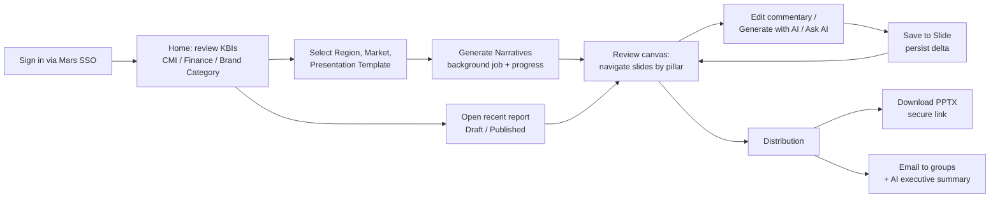
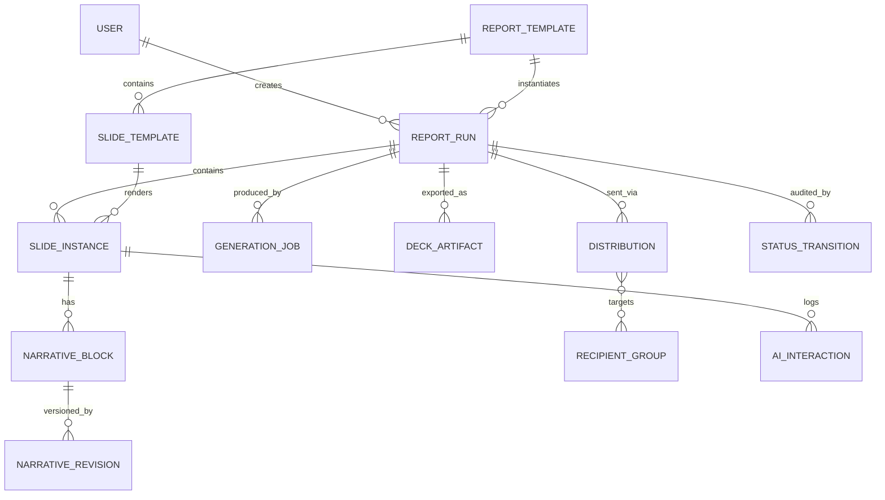

# FNOS Automation Engine — Project Discovery Report

| | |
|---|---|
| **Document status** | Discovery draft for external review — not an architecture decision record |
| **Prepared** | 2026-10-09 |
| **Scope of evidence** | Files present in the `FNOS/` workspace on 2026-10-09 only. No stakeholder interviews have been conducted. |
| **Next gate** | Architecture & implementation planning (after open questions in §15 are resolved) |

> **Path note (2026-10-12):** the workspace was reorganised after this document was written. File paths in backticks were updated to the new locations (the frontend POC moved to `archive/frontend-poc/`); the content and findings were not changed. See the repository `README.md` for the current layout.

### Finding labels

Every material finding carries one of these labels:

| Label | Meaning |
|---|---|
| **[Confirmed]** | Stated explicitly in a workspace artifact (source cited). |
| **[Inferred]** | Reasonable reading of the evidence, but not stated outright. Needs validation. |
| **[Proposed]** | Recommendation from this discovery. Not a requirement; requires approval. |
| **[Unknown]** | Cannot be established from the workspace. Requires clarification. |

### Source index

Citations in this report use these IDs.

| ID | Artifact | Notes |
|---|---|---|
| **S1** | `templates/FNOS_Automation_Template_Design_Deck_Final.pptx` | 58 slides, 25 MB. Cover reads "Template Design Final – 8th July"; file metadata last modified 2026-08-25. Cited as `S1 §n` (slide number). Much content lives in embedded images (`ppt/media/imageNN`), cited as `S1 img NN`. |
| **S2** | `plans/original/FNOS_App_Development_Plan.xlsx` → sheet *Webapp Plan* | 35 user stories, 14 weeks. Cited as `S2 rN` (row). A lock file `~$FNOS_App_Development_Plan.xlsx` (owner "Vishwachandra Lokesh") was present, so the workbook was open in Excel during discovery and may have unsaved edits. |
| **S3** | `plans/original/FNOS_Project_Plan_Initial_Draft.xlsx` → sheets *DS Team Plan* and *Webapp Plan* | Created by "Chakraborty, Sibashis (Contractor)" on 2026-10-08. Its *Webapp Plan* sheet is identical to S2. |
| **S4** | `assets/architecture/architecture-1.png` … `architecture-4.png` | Four iterations of one "FNOS Automation — Solution Architecture" diagram. They differ in layer order and layout, not in components. architecture-4 appears most refined; precedence has not been confirmed. |
| **S5** | `assets/ui-mockups/login.png`, `main_page.png`, `canvas.png`, `onclick_distribution.png` | High-fidelity UI mockups ("FNOS Narrative Engine"), dated 2026-10-09. |
| **S6** | `assets/prototype-screenshots/Screenshot 2026-10-06 095559.png`, `…095616.png` | Screenshots of the running S7 prototype (Step 2). |
| **S7** | `archive/frontend-poc/` | React 19 + Vite clickable prototype. |
| **S8** | `archive/poc/poc_generate_80_slides.py` | python-pptx proof-of-concept that generates an 80-slide deck. Its output is in `archive/frontend-poc/public/` and `frontend/dist/` (removed 12 Oct 2026; identical copy in `archive/frontend-poc/public/`); both copies are identical (same MD5). |
| **S9** | `archive/plan-scripts/generate_resequenced_plan.py`, `archive/plan-scripts/generate_plain_plan.py`, `archive/plan-scripts/apply_exact_draft_style.py`, `archive/plan-scripts/update_sudhakshina_be_plan.py` | Scripts that write S2/S3. They contain **dates, phase names and owner allocations not present in the XLSX**. |

---

## 1. Executive Summary

**What it is.** FNOS is an initiative for **Mars Food & Nutrition (F&N) Europe** to automate production of a recurring executive performance pack. The pack is a PowerPoint deck that combines Finance and Consumer & Market Insights (CMI) reporting. The workspace calls the solution the "FNOS Automation Engine" or "FNOS Narrative Engine" [Confirmed — S5, S7 `index.html`]. The expansion of "FNOS" is not stated [Unknown].

The initiative has three strands:

1. **Report template redesign** of about 44 existing report slides across four business pillars. This strand is designed and largely complete [Confirmed — S1].
2. **Data and AI workstream** (Data Science team): KPI logic mapping, Databricks pipelines, PPT template decomposition, GenAI insight synthesis, and web scraping of product reviews [Confirmed — S3 *DS Team Plan*].
3. **Web application**: users pick parameters, generate the deck from governed data, review and edit AI-drafted commentary on each slide, then download or email the deck [Confirmed — S2, S5, S7].

**Maturity.** The workspace contains **no production code, no backend, no data contracts, no KPI definitions, and no written requirements document.** What exists:

- design artifacts (S1, S4, S5);
- a fully mocked UI prototype (S7);
- a slide-generation POC that uses invented data (S8);
- a 14-week web-app plan and a ~11-week DS plan (S2, S3).

Requirements must be reconstructed from these artifacts and are mostly implicit.

**Indicated technology direction.** The plans and diagrams specify (not yet ratified):

- **Frontend:** React 19 + Vite SPA.
- **Backend:** Python FastAPI (+ GraphQL), on Azure App Service, with Azure Functions for rendering.
- **Data:** Databricks Silver/Gold layers, Azure SQL, Azure Blob Storage.
- **Identity and API:** Entra ID SSO, Azure API Management.
- **AI:** Azure OpenAI (GPT-4o) via Azure AI Foundry, AI Search, content safety.
- **Email:** Microsoft Graph or SendGrid.

**Most significant findings**

1. **Scope is not quantified consistently.** The plan targets an "80-slide deck" (S2 r21, r28, r35). The design deck defines about 44 report templates, some "repeated for Dolmio UK, Bens UK, Suzi Wan FR, RTH D, Ready Meals UK" (S1 img 61). The figure 80 can be traced only to the POC (S8), which **pads with filler agenda slides to reach exactly 80**. The true slide inventory is undefined.
2. **The AI architecture and the plan disagree.** The architecture shows a multi-agent orchestrator (Router, Manager, SQL, Python, Insights, Summarizer and Custom agents, with "deterministic" and "dynamic" insight paths) (S4). The web-app plan has no stories for building it; it plans only a commentary API, an executive summary, and a Q&A chat (S2 r24–r29).
3. **KPI semantics and data sources are the critical path, and none are documented.** Examples include NSV, RIG, MAC, A&CP, TLI/QGI, YEE, AEP, TDP, WD and ROS. Sources include "1CON/DDaS", Redslim and Databricks Gold. Until KPI definitions and Gold-layer contracts exist, backend data integration (plan weeks 5–6) cannot complete.
4. **Hallucination and financial-accuracy risk is unaddressed.** The prototype's mock AI responses invent figures such as elasticities, "£400k TikTok" and "85 bps of gross margin" (S7 `App.jsx` L69–103). Nothing in the plan specifies how generated numbers are verified against source data.
5. **The schedule is aggressive and has gaps.** Two named developers have 14 weeks (W1 = 12 Oct 2026, end 17 Jan 2027 per S9). Weeks 11–12 fall over Christmas and New Year. The plan has no UAT, no automated testing, no CI/CD or IaC, no non-production environments, and no observability stories, although all of these appear in the architecture (S4). It also sets a "sub-second" target for generating 80 slides (S2 r35) that conflicts with the planned serverless background job and progress streaming (S2 r18–r19, r28).
6. **Key workflow rules are absent.** Nothing defines who may generate, edit, certify ("Governance Status: Certified"), publish or distribute a report, or the Draft → Published lifecycle shown in the mockups.

**Recommendation.** Do not start the 14-week build as planned. First hold a short **discovery-closure phase** (1–2 weeks, [Proposed]) to agree:

- the report and slide inventory;
- the KPI dictionary and Gold-layer data contracts;
- a canonical slide content model (one source of truth for the web canvas and the PPTX);
- the AI accuracy guardrails;
- the RBAC and workflow rules;
- the AI-orchestration scope.

Then build a thin **end-to-end vertical slice** (one pillar, e.g. EU Overview's two reports) before widening scope.

---

## 2. Project Purpose and Business Context

### 2.1 Business context

| # | Finding | Label | Source |
|---|---|---|---|
| 2.1.1 | The organisation is Mars, Incorporated — Food & Nutrition, Europe. Brands in the evidence: Dolmio, Ben's Original (abbreviated "Bens"/"BENS"), Suzi Wan, Tilda, Seeds of Change, MasterFoods, and Ready Meals. | Confirmed | S1 §22, §36–40, img 122, img 131; S5 |
| 2.1.2 | Existing reports are manually built PowerPoint slides. They carry Excel-style tables, sticky-note reviewer comments ("Add YEE and vs. target?", "Need YEE (instead of MAT)"), owner tags ("Richard", "Finance") and cadence tags ("Quarterly Update", "Periodic Update", "Share Quarterly – PBR/GFNLT", "Update periodically"). | Confirmed | S1 img 25, 38, 62, 88 |
| 2.1.3 | Reports are grouped into four business pillars: **EU Overview**, **Financial Performance**, **Drive Relevance** and **Execute with Excellence (SRM)**. | Confirmed | S1 §3, img 20 |
| 2.1.4 | Reports are reviewed in governance forums with cadence. "PBR" and "GFNLT" appear as forum names. | Confirmed (names) / Unknown (meaning) | S1 img 62, 88 |
| 2.1.5 | Reporting follows the Mars period calendar (P1, P4, P5, P11, "C6 June", W202616). The design must therefore support a non-Gregorian fiscal calendar. | Inferred | S1 §10, §49, img 38, 122, 131 |

### 2.2 Business problem

| # | Problem | Label | Source |
|---|---|---|---|
| 2.2.1 | Reports are visually dense and hard to scan: heavy black and yellow blocks, cramped grids, floating sticky notes. | Confirmed | S1 §5–§57 "Design principles" text |
| 2.2.2 | Commentary is missing or empty. Commentary boxes are blank placeholders ("Financial Commentary – Q1/YTD" empty; "Key Highlights" blank). | Confirmed | S1 img 25, 38; S1 §11 "Converts a blank, rigid placeholder box…" |
| 2.2.3 | Producing the pack is manual and repetitive. Some slides are repeated per brand-market. | Inferred (from the automation intent and the repetition in S1 img 61) | S1 img 61; S3 DS r9–r11 |
| 2.2.4 | Data gaps and reviewer requests (YEE, vs. target) are tracked informally on the slides themselves. | Confirmed | S1 img 25, 62 |

**Stated goal:** "From Static Reports to Executive Decision-Making … enabling faster insight consumption while establishing a scalable foundation for future enhancements." [Confirmed — S1 img 20]

### 2.3 Primary business objectives

| # | Objective | Label | Source |
|---|---|---|---|
| O1 | Modernise the presentation of ~44 F&N EU reports to a consistent, executive-ready design system. | Confirmed | S1 |
| O2 | Automate deck generation from governed data (Databricks Gold layer). | Confirmed | S2 r15, r28; S3 DS r5–r11; S4 |
| O3 | Add AI-generated narrative ("AI Co-Pilot": data-gap detection, narrative recommendations, Headline / So What / Now What). | Confirmed | S1 §5, §9, §22, img 26, 89; S7 |
| O4 | Let users edit narrative per slide and persist edits. | Confirmed | S2 r16, r22 |
| O5 | Distribute the finished deck to stakeholder groups by download or email, with an AI-drafted executive summary. | Confirmed | S2 r23, r26, r27, r31; S5 onclick_distribution |
| O6 | Measurable outcomes: time saved per cycle, cycle time, adoption, narrative acceptance rate. | **Unknown** | — No KPIs or success criteria are defined anywhere. |

---

## 3. Existing Workspace Inventory

### 3.1 File inventory

| Path | Type | Purpose | Assessment |
|---|---|---|---|
| `templates/FNOS_Automation_Template_Design_Deck_Final.pptx` | PPTX, 58 slides | Before/after redesign catalogue for every in-scope report, with design rationale | **Primary functional source.** Read in full: text, speaker notes and the key images. Slide notes contain unresolved edit instructions (see §15). |
| `plans/original/FNOS_App_Development_Plan.xlsx` | XLSX | 14-week web-app backlog (Epic / Feature / Story / Layer / Owner / weeks) | Read in full. The Gantt is encoded only as cell fill colour; week columns contain no values. |
| `plans/original/FNOS_Project_Plan_Initial_Draft.xlsx` | XLSX, 2 sheets | DS team plan (16 stories) plus a copy of the web-app plan | Read in full. The DS sheet has 20 week columns but bars end at week 11. |
| `assets/architecture/architecture-1..4.png` | PNG | Solution architecture iterations | Read. |
| `assets/ui-mockups/login.png`, `main_page.png`, `canvas.png`, `onclick_distribution.png` | PNG | Target UI mockups | Read. **The canvas mockup differs materially from the prototype** (see §8.2). |
| `assets/prototype-screenshots/Screenshot 2026-10-06 *.png` | PNG | Prototype screenshots | Read. |
| `archive/frontend-poc/` | React/Vite project | Clickable prototype | Read. See §8. |
| `archive/poc/poc_generate_80_slides.py` | Python (python-pptx) | Proves that 80 editable slides can be generated quickly | Read. Data is fictional. |
| `archive/plan-scripts/generate_resequenced_plan.py`, `archive/plan-scripts/generate_plain_plan.py`, `archive/plan-scripts/apply_exact_draft_style.py`, `archive/plan-scripts/update_sudhakshina_be_plan.py` | Python (openpyxl) | Generate and reshape the plan workbooks | Read. Each holds a **different version** of the backlog (owners and stories differ). They reference output files not present in the workspace (`…_14Weeks.xlsx`, `…_14Weeks_v2.xlsx`, `…_Plain.xlsx`, `…_Initial_Draft_Style.xlsx`). |
| `~$FNOS_App_Development_Plan.xlsx` | Excel lock file | — | Shows S2 was open in Excel during discovery. |

### 3.2 Documents not available

| Missing artifact | Impact |
|---|---|
| Business requirements document, product brief or statement of work | Scope, success criteria and acceptance criteria are reconstructed, not authoritative. |
| KPI / metric dictionary (definitions, formulas, grain, sources) | Blocks data integration, validation and AI guardrails. |
| Databricks Gold-layer schema or data contract | Blocks backend API design (S2 r13–r15). |
| Original "master template" deck (the one to be deconstructed per S3 DS r9) | S1 shows images of slides, not the editable master. |
| "Esther Deck" referenced in S1 §22 notes ("ADD – Slide #2 in Esther Deck") | Unknown content. |
| Security, compliance or AI-use policies (Mars) | Cannot confirm requirements for data classification, residency or AI governance. |
| Non-functional requirements (users, concurrency, SLAs) | Cannot size infrastructure. |
| Test strategy, environment strategy, release process | Not defined. |

### 3.3 Version control

**[Confirmed]** In WSL, `git` reports that `/mnt/d/Code/Work/Mars/FNOS` is **not a git repository**, and no `.git` directory exists in the workspace. The IDE's context reported a `master` branch, which may reflect a Windows-side repository elsewhere [Unknown]. Repository location and branching strategy need confirmation.

---

## 4. Confirmed Requirements

These are requirements with direct evidence. Requirements that exist only in the plan (S2) are marked accordingly: the plan is a delivery artifact, not a signed-off requirement source.

### 4.1 Report content and design (from S1)

| ID | Requirement | Label | Source |
|---|---|---|---|
| R-D1 | The redesigned reports cover four pillars: EU Overview (2 reports), Financial Performance (6), Drive Relevance (10 distinctive + 22 in a repeated set), Execute with Excellence/SRM (4). | Confirmed | S1 img 24, 37, 61, 121 |
| R-D2 | Product Quadrant Analysis and Ready Meals Europe All Category Slides are in the **backlog** (out of current scope). | Confirmed | S1 §56, img 130 |
| R-D3 | Each redesigned report follows common principles: KPI cards; modular card layout; whitespace; a dedicated commentary side panel in place of sticky notes; consistent palette (soft greens, deep blues); pill status tags; a breadcrumb header; and an "AI Co-Pilot" / "AI Data Assistant" panel. | Confirmed | S1 §5–§57 |
| R-D4 | The AI panel surfaces **data gaps** (e.g. "Data gap detected: consider incorporating YEE") and **narrative recommendations**. | Confirmed | S1 §5, img 26 |
| R-D5 | The topline summary uses a **Working / Not Working / Actions** structure, with an AI Co-Pilot panel of key findings (e.g. customer-level risks) and prioritised recommended actions (HIGH/MED). | Confirmed | S1 §29, img 89 |
| R-D6 | The Topline Category/Brand headline slide holds a "Headlines / SO WHAT / NOW WHAT (ACTION)" narrative, a shopper-metrics table (12 weeks vs YA, MAT vs YA: RSV, Units, Penetration, Brand Value Share, RSV Share, Units Share, Val ROS, Unit ROS, TDP Share, Penetration % U35s, Buyers/Repeat), and an "Elevator Pitch: Maximum 3 sentences … remember the WHY!". It is **quarterly**. | Confirmed | S1 §22 |
| R-D7 | A scenario modelling action appears in the P&L Co-Pilot ("scenario modeling button"). | Confirmed (design) / Unknown (function) | S1 §9 |

### 4.2 Application (from S2, S5, S7)

| ID | Requirement | Label | Source |
|---|---|---|---|
| R-A1 | Users sign in through Mars federated SSO (Azure AD / Entra ID) using an `@effem.com` identity. | Confirmed | S2 r4, r6; S5 login |
| R-A2 | The main page shows a KBI header (RSV, Market Share, Volume, Weighted Distribution, HH Penetration) with tabs **CMI / Finance / Brand Category**. | Confirmed | S2 r7; S5 main_page |
| R-A3 | Users select parameters: **Region**, **Market**, **Presentation Template**. | Confirmed | S2 r8; S5 main_page |
| R-A4 | Users see recent reports (e.g. FNOS_26_Q1/Q2/Q3) with Brand, Template, View (e.g. "Total Europe Cluster"), Updated date, status (**Published / Draft**), and a share action. | Confirmed | S2 r9; S5 main_page |
| R-A5 | "Generate Narratives" starts deck generation. Progress is streamed to the UI (SSE). | Confirmed | S2 r18–r19; S5; S7 |
| R-A6 | The canvas shows slides at 16:9 with navigation. The mockup uses a **Reports Library** accordion grouped by pillar; the plan says "slide thumbnail navigation". | Confirmed (both) — **conflict**, see §15 | S2 r10–r11; S5 canvas |
| R-A7 | Per-slide commentary editor with **Save to Slide**. Edits persist as "narrative deltas" in Azure SQL. | Confirmed | S2 r16, r20, r22 |
| R-A8 | A right-side AI panel has commentary regeneration and a conversational Q&A assistant (streamed). | Confirmed | S2 r20, r29; S7 |
| R-A9 | Interactive charts for brand share and trend slides. | Confirmed | S2 r30 |
| R-A10 | Distribute modal: download PPTX; report title; recipient **groups** (Executive Board, Regional Managers, Marketing Team, + Add Group); AI executive summary with **Regenerate**; Send. The modal shows Region, Market Coverage, Slide Template and **Governance Status (Certified)**. | Confirmed | S2 r23, r26; S5 onclick_distribution |
| R-A11 | Email dispatch through Microsoft Graph API **or** SendGrid. | Confirmed (undecided) | S2 r27 |
| R-A12 | PPTX generated by a serverless worker (Azure Function), stored in Azure Blob, downloaded through **secure temporary links** (SAS). | Confirmed | S2 r28, r31; S9 |
| R-A13 | Performance: data caching for fast slide navigation; "sub-second" 80-slide generation target. | Confirmed (plan) | S2 r17, r35 |
| R-A14 | Accessibility and cross-browser compatibility. | Confirmed (no standard named) | S2 r32 |
| R-A15 | Release is a production container build handed to a "Testing Team". | Confirmed | S2 r36 |

### 4.3 Data and AI (from S3 DS plan)

| ID | Requirement | Label | Source |
|---|---|---|---|
| R-DS1 | KPI logic mapping for Finance (Financial Performance; Drive Relevance and EU Overview) and CMI (Drive Relevance). | Confirmed | S3 DS r2–r4 |
| R-DS2 | Finance and CMI data pipelines, with KPI validation and ETL testing. | Confirmed | S3 DS r5–r8 |
| R-DS3 | Deconstruct the master template into reusable assets. Build Python scripts that generate slides from processed data. | Confirmed | S3 DS r9–r11 |
| R-DS4 | GenAI: knowledge base creation and integration ("pre-processed analytical layer"), prompt tuning and guardrails, review and validation. | Confirmed | S3 DS r12–r15 |
| R-DS5 | Web scraping of **product reviews**, summarised into insights. | Confirmed | S3 DS r16–r17 |

---

## 5. Functional Modules and Features

The modules below combine S1, S2, S3, S4 and S5. Ownership indicates the team in the plan.

| # | Module | Key features | Owner (per plan) | Evidence | Label |
|---|---|---|---|---|---|
| M1 | **Identity & Access** | Entra ID SSO, JWT validation, session, user profile | Web app | S2 r4–r6; S4 | Confirmed |
| M2 | **Home / Parameter Selection** | KBI header + tabs; Region/Market/Template selection; recent reports; "View all" | Web app | S2 r7–r9, r14; S5 | Confirmed |
| M3 | **Report Catalogue & Template Registry** | Pillar → report → slide template definitions; brand-market repetition rules; cadence (quarterly, periodic) | DS (template decomposition) + Web app (template engine) | S1; S2 r12; S3 DS r9–r10 | Inferred — the module boundary is not defined anywhere |
| M4 | **Data Access Layer** | Databricks Gold queries; Azure SQL app tables; caching | Web app (BE) consuming DS-owned data | S2 r13–r15, r17 | Confirmed |
| M5 | **Deck Generation / Presentation Orchestrator** | Background jobs; progress via SSE; slide population; PPTX rendering (Azure Function) | Web app (BE) **and** DS (Python slide scripts) — **overlap** | S2 r18–r19, r28; S3 DS r11; S4 | Confirmed — ownership conflict |
| M6 | **Review Canvas** | 16:9 viewer; navigation; interactive tables and charts | Web app (FE) | S2 r10–r11, r21, r30; S5 canvas | Confirmed |
| M7 | **Commentary & Narrative** | Per-slide blocks (Headline / So What / Now What; custom blocks); AI generate/regenerate; save; persistence of deltas | Web app + DS (prompts) | S2 r16, r20, r22, r24–r25; S3 DS r14–r15; S7 | Confirmed |
| M8 | **AI Insights Assistant** | Conversational Q&A over data; suggested prompts; ad-hoc charts | Web app (BE) + DS (knowledge base) | S2 r29; S3 DS r12–r13; S7 | Confirmed |
| M9 | **AI Orchestration (agents)** | Router agent; deterministic path (SQL agent → Insights agent); dynamic path (Manager agent → SQL/Python/Insights/Custom agents with task dependencies); Summarizer agent | **Not planned** in S2 or S3 | S4 | Confirmed (architecture) / Unknown (delivery owner) |
| M10 | **Distribution** | Download; email to groups; AI executive summary; recipient group management | Web app | S2 r23, r26–r27, r31; S5 | Confirmed |
| M11 | **Report Lifecycle & Governance** | Draft / Published status; "Governance Status: Certified"; versioning | Not planned | S5 main_page, onclick_distribution; S7 L1293 | Inferred — the UI shows it but no rules exist |
| M12 | **External Insights (web scraping)** | Product-review scraping and summarisation | DS | S3 DS r16–r17 | Confirmed — **integration into the app is undefined** |
| M13 | **Administration** | Manage recipient groups, templates, users and roles | Not planned | S5 "+ Add Group" | Inferred / Unknown |
| M14 | **Platform & Operations** | CI/CD (Azure Pipelines → Container Registry), monitoring (Azure Monitor, App Insights, Log Analytics), Key Vault | Not planned as stories | S4 | Confirmed (architecture) / gap in plan |

### 5.1 Report inventory (in-scope templates)

Source: S1 img 24, 37, 61, 121, 130 and S1 slide titles.

| Pillar | Reports | Notes |
|---|---|---|
| **EU Overview** (2) | F&N EU Strategic Cells Overview MAT/YTD; F&N EU Brand Overview | Strategic cells: Seed / Growth Engine / Fuel for Growth / Harvest (S1 img 25–26) |
| **Financial Performance** (6) | F&N EU P&L; "Q2 back to topline/volume growth but significantly impacted on bottom line by EPR cost fully booked in P4" (a headline-titled chart slide); Qxx F&N Disaggregated Results – Cluster View; – Brand View; Italian (excl. RM) EU P&L; RTH (excl. RM) EU P&L | One report "name" is a period-specific headline. That implies AI- or author-generated **slide titles**. |
| **Drive Relevance – distinctive** (10, source slides 17–26) | Top Customers & Channels: Overview; Growth Double Click; Total Europe Internal – Brand View by Partition; – by Cluster; Category/Partition Summary; Executive Summary – Category Tailwinds & Headwinds; Total Europe External – Brand Share; External Brand & Competitor – Share Summary; External RSV & Share – Partition; – Retailer | S1 §21 notes say "Remove"; S1 §23 notes say "Replace with Working/Not Working (Slide 29)". |
| **Drive Relevance – repeated set** (22, source slides 27–48) | Topline Category – Brand Headline; Topline Summary – Working/Not Working/Actions; Category View – Category Lead in VCD; Channel/Customer View – Category Lead in VCD; SRM Promo View – SRM Lead in VCD; Perfect Store – Quarterly Update; Dolmio UK – PQA Overview; Perfect Commerce Metrics: Share of Shelf; TDP/Perfect Store Headlines & Key Themes; Quarterly Category WD by SKU; Strategic Cell – Channel & Market; – Customer; – Partition; Italian EU P&L Overview – YEE vs AEP; VCD Scorecard – External Performance C6 June; Italian EU P&L Overview – PTD; – YTD; Ben RTH UK – External Performance; Ready Meals UK – External Performance; RTH D – External Performance; Suzi Wan FR – External Performance; Brand View – Marketing Lead in VCD | Header: "Repeated for Dolmio UK, Bens UK, Suzi Wan FR, RTH D, Ready Meals UK". **It is ambiguous** whether these 22 are each repeated per brand-market, or are already the per-brand instances. |
| **Execute with Excellence / SRM** (4) | SRM Cluster Scorecard P5 YTD; Growth & Leverage Matrix (By Market YTD); (By Strategic Cell YTD); (By Top 10 Customer YTD) | The coverage list says "P5 **2025**"; the source slide says "P5 **2026**". |
| **Backlog** | Product Quadrant Analysis; Ready Meals Europe All Category Slides | PQA source is a Redslim-powered dashboard (S1 img 131). |

---

## 6. User Roles and Permissions

**No role model is defined anywhere in the workspace [Unknown].** The roles below are inferred from report ownership tags, slide titles and UI copy. Each needs validation.

| Candidate role | Evidence | Likely responsibilities | Label |
|---|---|---|---|
| **Report Author / Analyst** (Finance) | "Finance" owner tag (S1 img 62); "Richard" tag on Finance slides (S1 img 25, 38) | Generate decks; review numbers; write or approve commentary | Inferred |
| **Report Author / Analyst** (CMI) | CMI tab (S5); "Drive Relevance" CMI KPI logic (S3 DS r3) | As above, for consumer and market insight slides | Inferred |
| **Category Lead / Marketing Lead / SRM Lead** | Slide titles "Category Lead in VCD", "Marketing Lead in VCD", "SRM Lead in VCD" (S1 §30–§33) | Own or consume specific views. **"VCD" is undefined.** | Inferred |
| **Governance Certifier** | "The selected Executive Deck is governance-certified by the Insights leadership board" (S7/S6); "Governance Status: Certified" (S5) | Certify templates and/or decks before distribution | Inferred — scope of certification (template vs instance) Unknown |
| **Recipient / Consumer** | Recipient groups: Executive Board, Regional Managers, Marketing Team (S5) | Receive the distributed deck; may not need app access | Inferred |
| **Administrator** | "+ Add Group" (S5) | Manage groups, templates, access | Inferred |
| **Data Science / Data Engineering** | S3 | Own pipelines, KPI logic, prompts and the knowledge base | Confirmed (team) |

**Questions this raises [Unknown]:**

- Is data access restricted by market, brand or cluster (row-level security)?
- Can a UK analyst see France P&L?
- Who may distribute, and may they send outside a pre-approved group list?
- Are Finance P&L slides more restricted than CMI slides?

---

## 7. Primary User Workflows

### 7.1 Core workflow (as designed)

Derived from S5 and S7. S7 uses a three-step flow: "STEP 1/2/3 OF 3".

| Step | Detail | Label |
|---|---|---|
| Sign in | Entra ID SSO; `effem.com` email | Confirmed (S5, S2 r4–r6) |
| Parameters | Region, Market, Template. S7 also has **Reporting windows** (MAT, YTD, L12W, L4W); this is absent from the mockup and the plan. | Confirmed / conflict |
| Generate | Long-running job with progress. In S7 the steps are "Router Agent initializing", "SQL Agent querying Databricks Gold Layer", "Insights & Summarizer Agents generating executive narrative blocks". | Confirmed (S7 L53–66, S2 r18–r19) |
| Review/edit | Commentary blocks per slide; AI regenerate; Q&A with suggested prompts ("Analyse pricing sensitivity by cell", "Estimate future RIG momentum", "Highlight Harvest cell drag"). | Confirmed (S7) |
| Distribute | Download or email | Confirmed (S5, S2) |

### 7.2 Workflows that are implied but undefined

| Workflow | Why it matters | Label |
|---|---|---|
| Draft → Review → Certified → Published lifecycle | Status badges and "Certified" are shown, but transitions, approvers and audit are undefined. | Unknown |
| Re-opening a published report; versioning after data restatement | Finance data is restated; a published deck must be reproducible. | Unknown |
| Periodic / scheduled generation (e.g. on data refresh) | Reports are quarterly or periodic (S1). Architecture shows "Manual Triggers" only (S4). | Unknown |
| Multi-author collaboration on one deck | Finance and CMI slides likely have different authors. Concurrent edit behaviour is undefined. | Unknown |
| Handling data gaps flagged by AI (e.g. missing YEE) | S1 shows the AI flagging gaps. Nothing defines who resolves them, or how. | Unknown |
| Template change management (adding or removing a slide; S1 notes "Remove", "Replace with slide 22") | The template set is still changing. | Unknown |

---

## 8. Existing Technical Assets

### 8.1 Frontend prototype (`archive/frontend-poc/`)

| Aspect | Finding | Label |
|---|---|---|
| Stack | React ^19.2.8, react-dom, lucide-react ^1.52.0; Vite ^8.3.0 with `@vitejs/plugin-react` ^6.1.1; oxlint ^1.81.0 (`archive/frontend-poc/package.json`). JavaScript (JSX), **not TypeScript**, although `@types/react` is installed. | Confirmed |
| Structure | One component: `src/App.jsx` (1,427 lines) with **inline styles throughout**, plus `App.css`/`index.css`. No routing, state library, API client, tests, environment config or auth. | Confirmed |
| Behaviour | Entirely mocked. `setTimeout` simulates generation, AI regeneration and chat. Hard-coded KPIs, commentary and 5 slides. "Send Report" calls `alert()`. "Download" links to the static POC PPTX in `public/`. | Confirmed (`App.jsx` L53–103, L1301, L1404) |
| Content mismatches vs S1/S5 | Prototype slide titles ("Brand Equity & Share Performance", "Marketing Spend & ROI Calibration", "Strategic Growth Outlook") **are not in the S1 inventory**. Region list includes "North America". Template options are "FNOS Executive Deck / Brand Review Pack / Quarterly Financials". KBI tabs are labelled "Consumer & Market Insights" etc. rather than "CMI / Finance / Brand Category". | Confirmed |
| Hard-coded identities | Header shows `akhil.kumar@tigeranalytics.com`; recipient default `richard.branson@mars.com, sarah.director@mars.com`. These are placeholders, not requirements. The first suggests the delivery partner is Tiger Analytics. | Confirmed (values) / Inferred (partner) |
| Build artifacts | `dist/` is committed alongside source and `.gitignore` excludes it. `node_modules/` was installed on **Windows** (`lightningcss-win32-x64-msvc`, `.cmd` shims), so it will not run unchanged under WSL/Linux. | Confirmed |
| External dependencies | Google Fonts (Plus Jakarta Sans, Inter) loaded from `fonts.googleapis.com` (`index.html`). Corporate CSP or privacy policy may prohibit this. | Confirmed / risk |
| Reuse value | Useful as an **interaction reference** only. It should not be the code base for production: single file, inline styles, no state or data architecture. | Proposed |

### 8.2 Target UI mockups (S5) vs prototype (S7)

| Area | Mockup (S5, 2026-10-09) | Prototype (S7, 2026-10-07) |
|---|---|---|
| Product name | "FNOS Narrative Engine" | "Automation Engine" |
| Home | KBI cards; "Confirmation and Logic Mapping" with Region / Market / Template; Recent FNOS Reports cards | Same, plus Reporting windows chips and a "Corporate Database Connection Active – P01 2026 data" status |
| Canvas | **Reports Library** accordion by pillar (EU Overview, Financial, Drive Relevance, SRM) with thumbnails; full-width report; "AI CO-PILOT" toggle; "Quarterly Update" tag; "Distribution" CTA | Slide sorter (5 slides); slide + **right-hand Commentary / Insights & Charts panel**; "Save to Slide"; "Continue to Share" |
| Distribution | Modal | Full page (Step 3) |

**[Inferred]** S5 is the newer target design. The commentary and AI side panel from S7 is not visible in the S5 canvas (only an "AI CO-PILOT" chip), so how S5 handles editing is unclear [Unknown].

### 8.3 PPTX generation POC (`archive/poc/poc_generate_80_slides.py`)

| Finding | Label |
|---|---|
| Uses `python-pptx` to build 16:9 slides from native shapes, tables and text, so output stays editable. Not installed in this environment; not executed during discovery. | Confirmed |
| Deck structure: cover, agenda, regional KBI slide, then 10 markets × 7 slides (UK, DE, FR, IT, ES, NL, PL, BE, SE, CH), then **filler agenda slides "to reach exactly 80"**, then sign-off. | Confirmed (L697–760) |
| Market–brand mapping is fictional (e.g. Sweden → Dolmio, Switzerland → Seeds of Change). Not a requirement. | Confirmed (values) / Inferred (fictional) |
| **It does not use the S1 designs or a master template.** It hand-codes layouts in Python. That validates speed and editability, not template fidelity. | Confirmed |

### 8.4 Architecture diagrams (S4)

The diagrams show four layers:

| Layer | Components |
|---|---|
| 1. Frontend Access & Security | Users → Azure DNS → React app (Static Web Hosting) behind WAF/Firewall; Entra ID; Key Vault; Policies |
| 2. API Gateway | Azure API Management (policy routing, rate limiting), OAuth2 / JWT validation, Azure VNet |
| 3. Presentation Orchestrator | Azure App Services "Presentation Orchestrator" ↔ Python FastAPI & GraphQL (APIs/S2S). Agent graph (Router → deterministic: SQL Agent → Insights Agent; dynamic: Manager Agent → SQL / Python / Insights / Custom agents with task dependencies → Summarizer → Insights Summary). Azure Functions (serverless) for asynchronous slide rendering; App Services. "Manual Triggers"; "Simple Visual" vs "Complex Visual" routes (architecture-3/4). |
| 4. Data Management & Storage | 1CON/DDaS → Silver (pre-processed) → Gold (presentation data) in a unified data lake/warehouse; Databricks workflow for ETL/ELT orchestration |

Cross-cutting components:

- **AI:** Azure AI Foundry, OpenAI (GPT-4o), content safety filtering, Azure AI Search.
- **App database:** SQL, Azure Blob Storage.
- **Observability:** Azure Monitor, App Insights, Log Analytics, Monitor Dashboard.
- **CI/CD:** git → Azure Pipelines → Azure Container Registry.

**[Confirmed]** All four diagrams contain the same components. **[Unknown]** Which version is authoritative, and whether it has had enterprise-architecture review at Mars.

### 8.5 Plan-generation scripts (S9)

| Finding | Label |
|---|---|
| Phases and dates appear **only** in S9, not in the XLSX: **Phase 1** "Zero-Dependency Foundations & Interactive Prototype", W1–4 (12 Oct – 8 Nov 2026). **Phase 2** "Live Data Integration & Orchestration", W5–8 (9 Nov – 6 Dec). **Phase 3** "GenAI Synthesis, PPTX Engine & Distribution", W9–12 (7 Dec – 3 Jan 2027). **Phase 4** "Hardening, Latency Profiling & Final Code Freeze", W13–14 (4 – 17 Jan 2027). | Confirmed (S9) |
| Earlier backlog versions (`archive/plan-scripts/generate_resequenced_plan.py`) had stories that are absent from the current S2: "Accordion Reports Library UI", "Multi-Report Template Sync", "MSAL.js Auth Context (FE)", "Mars Design System & UI Tokens". | Confirmed |
| Owner allocation changed between versions. In the earlier version Sudhakshina had FE stories; in S2 all FE stories belong to Vishwachandra. | Confirmed |

---

## 9. Preliminary Data Model

**No schema exists.** S2 r13 and r22 say the app consumes a "DS-managed schema and application tables" and stores edits "in DS-provided Azure SQL tables". Ownership of the application schema is therefore assigned to DS, which is unusual and should be confirmed [Unknown].

### 9.1 Analytical domain (owned by DS / Databricks; read-only for the app)

The dimensions and measures below appear in S1 and S5. They are evidence of what the Gold layer must expose, not a schema.

| Category | Items observed | Label |
|---|---|---|
| **Dimensions** | Region (Europe); Market/Country (UK, FR, DE/"GER & AT", IT, IR); Cluster (EUR ARM, FR Pan Asian, UK RTH, UK DOL, GER & AT RTH, FR RTH, REM RTH, EUR DRY); Strategic Cell (Seed, Growth Engine, Fuel for Growth, Harvest); Brand (Dolmio, Ben's Original, Suzi Wan, Tilda, …); Competitor/Manufacturer incl. Private Label; Category / Segment / Partition; Customer/Retailer (Tesco, Asda, Sainsbury's, Rewe, Edeka, Morrisons, Co-op); Channel (Grocery, Dcomm, LAR); SKU; Time (Period P1–P13, Quarter, week W202616, "C6") | Confirmed (observed) |
| **Time windows / comparisons** | YTD, MAT, PTD, L12W/12 weeks, L4W, Quarter, vs PY/LY/YA, vs FY Plan, vs Forecast, YEE (Year-End Estimate), AEP, 2Y CAGR, MAT vs 2YAV | Confirmed (observed) |
| **Finance measures** | 3rd-party Volume, Net Sales (NSV), Organic Growth %, Price %, RIG %, MAC / MAC %, Earnings, Economic Profit, Overheads, A&CP, Controllable Cash, Cash from P&L, Fixed Asset Additions, Working Capital, Gross Profit %, Contribution %, Promo Investment TLI % / QGI %, ΔNSV/T, Net Price %, Δ$CGP | Confirmed (observed) |
| **CMI / external measures** | RSV, Units, Value/Unit Share, Penetration %, Penetration % U35s, Buyers/Repeat, Val ROS, Unit ROS, TDP / TDP Share, Weighted Distribution (WD), Share of Shelf, $/KG index to competitor, VSOD %, PQA quadrant (Blockbuster / Lame Duck / Weakening Cores / Sleeping Beauty) | Confirmed (observed) |
| **Upstream sources** | "1CON/DDaS" (S4); Databricks Silver/Gold (S4); Redslim (PQA dashboard, database "MARSCONSFOODUK") (S1 img 131); "Nielsen/Sprint" label on the market-share KPI (S7 L275) | Confirmed (names) / Unknown (contracts, refresh cadence, licensing) |

### 9.2 Application domain (owned by the app) — [Proposed] candidate entities

These entities are suggested for planning only, not a design.

| Entity | Purpose / key attributes (indicative) |
|---|---|
| `ReportTemplate` | Pillar, name, version, cadence, certification status, owner; brand-market repetition rule |
| `SlideTemplate` | Layout ID (from master-deck decomposition), data bindings (query/metric IDs), narrative block definitions, order |
| `ReportRun` (deck instance, e.g. "FNOS_26_Q2") | Parameters (region, market, template, period, windows), **data snapshot / as-of version**, status (Draft / In Review / Certified / Published), created_by |
| `SlideInstance` | Resolved data payload (frozen for reproducibility), render state |
| `NarrativeBlock` / `NarrativeRevision` | Block type (Headline, So What, Now What, custom), text, origin (AI / human / AI-edited), model and prompt version, author, timestamp |
| `GenerationJob` | Status, progress, errors, timings |
| `DeckArtifact` | Blob path, checksum, generated_at |
| `Distribution` / `RecipientGroup` | Title, summary, recipients, sent_by, sent_at, delivery status |
| `AIInteraction` | Prompt, retrieved context references, response, safety flags. Needed for audit and evaluation. |
| `StatusTransition` / audit log | Who changed what, and when |

**Key design considerations [Proposed]:**

- **Reproducibility.** A published deck must re-render identically after upstream data restatement. Either snapshot the slide data on generation or pin to a Gold-layer version.
- **Single slide content model.** Store slide content as structured data (JSON per slide template). Render it to both the web canvas and PPTX, rather than editing HTML and PPTX separately.
- **Schema ownership.** The application's transactional schema should be owned and migrated by the app team, separate from DS analytical tables. This contradicts S2 r13 and r22 and needs a decision.

---

## 10. External Integrations

| Integration | Purpose | Evidence | Status / open points | Label |
|---|---|---|---|---|
| **Microsoft Entra ID (Azure AD)** | SSO, JWT, groups | S2 r6; S4; S5 | App registration ownership, group-to-role mapping, conditional access | Confirmed |
| **Azure Databricks** (Gold layer) | KPI data | S2 r15; S4; S7 | Access path: SQL Warehouse vs REST vs replicated to Azure SQL? Service principal? Latency? | Confirmed / Unknown detail |
| **Azure SQL** | App DB and/or "DS-provided tables" | S2 r13, r22; S4 | Ownership and schema unknown | Confirmed |
| **Azure Blob Storage** | PPTX artifacts, SAS links | S2 r31; S4 | Retention, link expiry | Confirmed |
| **Azure OpenAI (GPT-4o) via Azure AI Foundry** | Commentary, summary, Q&A | S2 r24; S4 | Deployment region (EU data residency?), quota, model version lifecycle | Confirmed |
| **Azure AI Search** | Knowledge base / retrieval | S4; S3 DS r12–r13 | What is indexed? | Confirmed / Unknown content |
| **Azure AI Content Safety** | Filtering | S4 | Policy configuration | Confirmed |
| **Microsoft Graph API or SendGrid** | Email distribution | S2 r27 | **Undecided.** SendGrid is an external SaaS and may conflict with Mars policy for confidential content. | Confirmed (options) |
| **Azure API Management** | Gateway, rate limiting, JWT | S4 | Tier/cost; is it needed for an internal single-SPA app? | Confirmed |
| **Azure Functions** | Serverless PPTX rendering | S2 r28; S4 | Cold-start vs "sub-second" target; python-pptx memory for large decks | Confirmed |
| **Azure Pipelines, Container Registry** | CI/CD | S4; S2 r36 | No stories in plan | Confirmed (architecture) |
| **Azure Monitor / App Insights / Log Analytics** | Observability | S4 | No stories in plan | Confirmed (architecture) |
| **1CON / DDaS** | Upstream enterprise data | S4 | Undefined acronyms; DS-owned | Unknown |
| **Redslim** (syndicated retail data) | External market data | S1 img 131 | Licensing terms for redistribution in decks; refresh | Inferred |
| **Web scraping targets** (product reviews) | External sentiment | S3 DS r16–r17 | Sites, legal/ToS approval, data flow into the app | Unknown |
| **Google Fonts** | Typography in prototype | S7 `index.html` | May be blocked or non-compliant; self-host | Confirmed / risk |

---

## 11. Non-Functional Requirements

| Category | Evidence | Gap | Label |
|---|---|---|---|
| **Performance** | "Sub-second" 80-slide PPTX generation (S2 r35); data caching for fast navigation (S2 r17); query profiling, connection pooling (S2 r34) | No targets for page load, AI latency, or end-to-end generation including data and LLM calls. "Sub-second" is unrealistic once LLM narrative generation is included and contradicts the async job + SSE design. It is plausible only for the rendering step on warm infrastructure. | Confirmed (target) / conflict |
| **Scalability** | — | Number of users, concurrent generations, decks per cycle | Unknown |
| **Availability / reliability** | — | SLA, support hours, RTO/RPO, behaviour during month or quarter close | Unknown |
| **Accessibility** | "Accessibility, Cross-Browser Compatibility" (S2 r32); "accessible, semantic color palettes" (S1 §25) | Standard not named (e.g. WCAG 2.1/2.2 AA). The red/green variance encoding in S5 needs a non-colour cue. | Confirmed / Unknown standard |
| **Browser support** | S2 r32 | Which browsers and versions; is mobile in scope? | Unknown |
| **Data freshness** | "P01 2026 data active (Last updated …)" (S7) | Refresh cadence per source; how the app shows staleness | Unknown |
| **Auditability** | "Governance Status: Certified" (S5) | Audit trail requirements | Unknown |
| **AI quality** | Guardrails, review and validation (S3 DS r14–r15; S2 r25) | No acceptance criteria for narrative accuracy, tone, length (e.g. "max 3 sentences" — S1 §22) or evaluation method | Partially confirmed |
| **Localisation** | Currencies £, €, $ shown (S1 img 38 "USD Millions"; S7 "£106.7m") | Reporting currency rules; language (English only?) | Unknown |
| **Maintainability** | Monorepo, Pydantic, linters (S2 r2) | Coding standards, test coverage targets | Partially confirmed |

---

## 12. Security and Compliance Considerations

| # | Consideration | Basis | Label |
|---|---|---|---|
| SC1 | Data is **confidential commercial and financial information** (P&L, customer profitability by retailer, earnings, cash). Source slides carry "Confidential" footers. | S1 img 38, 62 | Confirmed |
| SC2 | Authentication via Entra ID SSO. Backend validates JWT. APIM enforces OAuth2. | S2 r6; S4 | Confirmed |
| SC3 | Authorisation model (RBAC, data-level restrictions by market, brand or P&L sensitivity) is **not defined**. | — | Unknown |
| SC4 | Secrets in Key Vault. Network isolation via VNet and WAF. | S4 | Confirmed (architecture) |
| SC5 | **LLM data handling.** Financial data sent to Azure OpenAI requires: an EU-region deployment (if residency applies), confirmation that abuse-monitoring data retention is acceptable or has been opted out per Mars policy, and Mars AI-governance approval. | S4 (GPT-4o) | Inferred requirement / Unknown policy |
| SC6 | **Numeric hallucination.** Narrative must not introduce numbers absent from source data. The prototype's simulated replies show exactly this failure mode. [Proposed] Number-grounding validation, cite-to-cell, and a human-in-the-loop sign-off before publishing. | S7 L69–103 | Confirmed (risk) |
| SC7 | **Prompt injection** via web-scraped product reviews (untrusted text) entering a knowledge base used for executive narrative. [Proposed] Isolate untrusted content and sanitise it before indexing. | S3 DS r16–r17; S4 AI Search | Inferred |
| SC8 | **Web-scraping legality** (site terms of service, GDPR if reviewer personal data is collected). | S3 DS r16 | Unknown — requires legal review |
| SC9 | **Email distribution.** Restrict recipients to internal domains or approved groups. Log every send. If SendGrid is chosen, confirm third-party processor approval. Prefer links over attachments for confidential decks. | S2 r27; S5 | Proposed |
| SC10 | **Download links.** Short-lived, user-bound SAS (or proxied download through an authorised API). Avoid anonymous, shareable URLs. | S2 r31 | Confirmed (intent) / Proposed (detail) |
| SC11 | **Third-party data licensing** (e.g. Redslim, Nielsen). Redistribution rights within decks and emails. | S1 img 131; S7 L275 | Unknown |
| SC12 | **Frontend supply chain.** Google Fonts loaded from a CDN; `dist/` committed. | S7 | Confirmed |
| SC13 | **Audit logging** of generation, AI interactions, edits, certification and distribution. | Implied by "governance-certified" | Inferred |

---

## 13. Technical Architecture Options

The documented target is in S4. The options below are offered **for evaluation, not decision**. Each option preserves the confirmed technology direction (Azure, React, Python, Databricks, Entra ID, Azure OpenAI).

### Option A — Architecture as drawn (S4)

The components are as listed in §8.4: Static Web App; APIM; App Service (FastAPI + GraphQL); Azure Functions renderer; a multi-agent orchestrator with deterministic and dynamic paths; Azure SQL; Blob; AI Search; full observability.

| Pros | Cons |
|---|---|
| Aligns with the diagrams already socialised. Clear separation of concerns. Enterprise controls (WAF, APIM) in place. | Many moving parts for two developers in 14 weeks. The **multi-agent dynamic path is unplanned.** REST *and* GraphQL doubles API surface without a stated need. Functions + python-pptx: cold starts and memory limits. APIM adds cost and configuration for a single internal SPA. |

### Option B — Simplified service + worker [Proposed for evaluation]

- One FastAPI service (REST only) on App Service or Azure Container Apps.
- A queue-backed worker in the same codebase (e.g. a Service Bus or Storage queue) for generation and rendering.
- SSE for progress.
- Azure SQL (app-owned schema) and Blob.
- Azure OpenAI called by a **deterministic pipeline**: SQL → computed facts → LLM narrative with schema-constrained output → validation. No open-ended agent planning in v1.
- APIM optional, depending on Mars standards.

| Pros | Cons |
|---|---|
| Fits team size and timeline. One deployable. Easier testing. Deterministic numbers by construction. Conversational Q&A can be added later as a separate, read-only capability. | Deviates from the socialised diagram, so it needs stakeholder buy-in. Less flexible for ad-hoc "complex visual" requests. |

### Option C — Batch-first generation

- Decks (data and draft narrative) are pre-generated by a scheduled job on Gold-layer refresh (Databricks workflow or app worker), matching the periodic/quarterly cadence in S1.
- The web app focuses on review, edit, certify and distribute.

| Pros | Cons |
|---|---|
| Removes interactive latency pressure ("sub-second"). Allows thorough AI validation before users see output. Matches how finance reporting cycles operate. | Less "on-demand". Parameter combinations must be bounded. Needs a trigger contract with DS. |

**Cross-cutting decisions independent of option [Proposed]:**

1. **Canonical slide model.** Define a JSON schema per slide template (data bindings + narrative blocks + layout ID). The React canvas and the PPTX renderer both consume it. This avoids two divergent renderers: the S7 HTML slides versus S8 python-pptx output.
2. **PPTX rendering approach.** Either populate placeholders in a decomposed master template (S3 DS r9–r10 intent) or construct slides programmatically (S8 approach). Template population yields higher brand fidelity. Programmatic construction gives more flexibility. A spike is needed on 2–3 representative S1 slides (a dense table, a chart, a narrative panel).
3. **Native charts.** PPTX charts should be native, editable chart objects, not images, if recipients edit decks. Confirm this requirement.
4. **Frontend.** Keep React + Vite. Adopt TypeScript, a router, a server-state library, and a component system aligned to the S1/S5 design tokens. A virtualised canvas/thumbnail strategy is needed if a deck really reaches ~80+ slides.

---

## 14. Risks, Dependencies, and Constraints

### 14.1 Risks

| ID | Risk | Likelihood | Impact | Mitigation [Proposed] |
|---|---|---|---|---|
| RK1 | **KPI definitions and Gold-layer contracts are late or ambiguous.** Backend data work (W5–6) depends on DS KPI logic and pipelines (DS W1–W4). | High | High | Agree data contracts in discovery closure. Use contract-tested fixtures. Integrate one pillar first. |
| RK2 | **Scope inflation from undefined slide count** (44 templates vs 80 slides vs brand-market repetition). | High | High | Baseline the report inventory with the product owner. Lock v1 scope. |
| RK3 | **AI produces incorrect financial statements** that reach executives. | Medium | Very high | Deterministic numbers. Constrained generation. Numeric grounding checks. Mandatory human approval before publish. Evaluation set. |
| RK4 | **Timeline.** Two developers, 14 weeks, a holiday period in W11–12, and no QA/UAT/DevOps stories. | High | High | Re-plan with explicit test, CI/CD, environment and UAT work. Account for holiday capacity. Use vertical slices. |
| RK5 | **Ownership overlap on PPTX generation** (DS Python scripts S3 DS r11 vs web-app Template Engine S2 r12 and Serverless Generator S2 r28). | High | Medium | Assign a single owner and interface (slide model in, PPTX out). |
| RK6 | **Multi-agent orchestration in architecture but unplanned.** | High | Medium | Decide v1 AI scope explicitly. Update the diagram or the plan. |
| RK7 | **Design deck still changing** ("Final" deck has notes: "Remove", "Replace with slide 22", "Add in place of slide 23", "ADD – Slide #2 in Esther Deck"). | Medium | Medium | Get design sign-off. Version-control templates. |
| RK8 | **Template fidelity.** Dense S1 designs (multi-level headers, conditional colouring, side panels) may be hard to reproduce faithfully in python-pptx. | Medium | Medium | Rendering spike on the hardest slides early. |
| RK9 | **Security/compliance approvals** (AI use, SendGrid, scraping, data residency) block go-live. | Medium | High | Start approvals in parallel immediately. |
| RK10 | **"Sub-second" target unachievable as specified.** | High | Low–Medium | Redefine as separate rendering-only and end-to-end targets. |
| RK11 | **Plan artifacts diverge** (multiple script versions, an XLSX open with possibly unsaved edits, dates only in scripts). | Medium | Low | Move the backlog to a tracked tool; one source of truth. |
| RK12 | **AI model lifecycle.** The pinned model (GPT-4o) may be retired or superseded within the project lifetime. | Medium | Medium | Abstract the model client. Confirm currently supported Azure OpenAI model versions and retirement dates before build. |

### 14.2 Dependencies

| Dependency | Needed by (web-app week) | Provider |
|---|---|---|
| KPI logic mapping, validated | W5 (Parameter & Report APIs) | DS (DS plan W1–W4) |
| Gold-layer tables + access (service principal, workspace, SQL warehouse) | W5 | DS / Mars data platform |
| Master template decomposition / reusable assets | W4 (Template Engine) | DS (DS plan W1–W3) |
| Knowledge base + prompts + guardrails | W9 (AI commentary) | DS (DS plan W2–W11) — **review and validation runs to W11, overlapping app build** |
| Entra ID app registrations, groups | W2–W3 | Mars IAM |
| Azure subscription, resource groups, networking, APIM, Key Vault | W1+ | Mars cloud platform team |
| Azure OpenAI deployment and quota | W9 | Mars AI platform |
| Email service approval | W10 | Mars IT / security |
| Testing team availability | W14 | Unknown |

### 14.3 Constraints

| Constraint | Label |
|---|---|
| Microsoft Azure ecosystem | Confirmed (S2, S4) |
| React 19 + Vite frontend; Python FastAPI + Pydantic backend; monorepo | Confirmed (S2 r2) |
| Databricks as analytical source | Confirmed (S2 r15, S4) |
| Output must be **editable PowerPoint** | Confirmed (S8 docstring "100% editable native shapes"; S2) |
| Named team: Vishwachandra (FE + BE), Sudhakshina (BE) for the web app; Ravirajbhai, Jesu, Kavya for DS | Confirmed (S2, S3) |
| Web-app timeline: 12 Oct 2026 – 17 Jan 2027 (14 weeks) | Confirmed (S9 only) |
| DS-plan start date | Unknown |

---

## 15. Missing Requirements and Open Questions

### 15.1 Conflicts and inconsistencies

| # | Conflict | Sources |
|---|---|---|
| C1 | Deck size: "80 slides" (plan, POC) vs ~44 templates with brand-market repetition (design) | S2 r21/r28/r35; S8; S1 img 61 |
| C2 | Canvas navigation: Reports Library accordion by pillar (mockup) vs slide thumbnail sorter (plan, prototype). The accordion story was dropped from an earlier plan version. | S5 canvas; S2 r10; S9 |
| C3 | Parameters: Region/Market/Template (mockup, plan) vs + Reporting windows MAT/YTD/L12W/L4W (prototype). The design also needs PTD, Quarter, YEE vs AEP. | S5; S7; S1 |
| C4 | Template list: "FNOS Executive Deck / Brand Review Pack / Quarterly Financials" (prototype) vs four pillars (design) | S7 L405–407; S1 |
| C5 | Region scope: "North America" option (prototype) vs Europe-only evidence elsewhere | S7 L356 |
| C6 | AI design: multi-agent orchestrator (architecture) vs commentary API + summary + chat (plan) | S4; S2 r24–r29 |
| C7 | API style: REST endpoints (plan) vs "FastAPI & GraphQL" (architecture) | S2 r14; S4 |
| C8 | App DB ownership: "DS-provided Azure SQL tables" (plan) vs dedicated "App Database" (architecture) | S2 r13/r22; S4 |
| C9 | PPTX generation owner: DS (Kavya) vs web app (Sudhakshina/Vishwachandra) | S3 DS r11; S2 r12, r28 |
| C10 | Performance: "sub-second" generation vs long-running background job with progress streaming | S2 r35 vs r18–r19 |
| C11 | Report period: "SRM Cluster Scorecard P5 **2025** YTD" (coverage list) vs "P5 **2026** YTD" (slide) | S1 img 121 vs §52, img 122 |
| C12 | Deck labelled "Final" but contains unresolved edit notes | S1 §21, §22, §23, §28, §29 |
| C13 | "Real-Time Progress Streaming" (SSE) is tagged FE-only in S2, but was "FE + BE" in S9. The backend SSE endpoint is unowned in S2. | S2 r19; S9 |

### 15.2 Open questions by audience

**Product owner / business sponsor**

1. What does **FNOS** stand for? Who is the accountable business owner and who signs off scope?
2. What is the exact v1 deck: which of the 44 templates, in what order, for which brand-markets? Does "Repeated for Dolmio UK, Bens UK, Suzi Wan FR, RTH D, Ready Meals UK" mean 22 × 5 instances? Where does "80 slides" come from?
3. Is the output one consolidated pack, or several packs (per pillar, per brand-market, per forum such as PBR/GFNLT)?
4. What are the success metrics (hours saved, cycle time, adoption, narrative acceptance rate)?
5. What do "Brand Category" (tab), "VCD", "PBR", "GFNLT", "1CON/DDaS", "TLI/QGI", "AEP", "RTH", "ARM", "DOL", "RM" mean?
6. Is non-Europe (e.g. North America) ever in scope?
7. Is the **scenario modelling** button (S1 §9) in scope? What would it model?
8. How do web-scraped product reviews surface in the deck or app?
9. What does the backlog item "Ready Meals Europe All Category Slides" cover, and when is it planned?

**Business analyst / report owners (Finance, CMI)**

10. For each KPI: formula, grain, source, refresh cadence, and sign conventions. For example, why does Strategic Cells show "% NSV Growth YoY 638.7%"?
11. Which period calendar applies (Mars 13-period?), and how are PTD/YTD/MAT/YEE defined?
12. Who writes commentary today, per slide? Which blocks are AI-drafted, which human-only, which mandatory?
13. What is the lifecycle (Draft → Review → Certified → Published)? Who certifies, and is certification of the **template** or the **deck instance**?
14. What happens when data is restated after publication?
15. Are there data-level access restrictions (by market, brand, P&L)?
16. Who are the recipient groups, who maintains them, and may decks be sent externally (e.g. to agencies such as "Publicis", mentioned in S1 img 89)?

**Engineering manager / architecture**

17. Which architecture diagram is authoritative? Has Mars enterprise architecture reviewed it?
18. What is the v1 AI scope: deterministic narrative only, or also the dynamic multi-agent path and conversational Q&A?
19. REST, GraphQL, or both — and why?
20. Who owns the app's transactional schema and migrations?
21. How does the app access Gold data (Databricks SQL Warehouse, Unity Catalog permissions, service principal)? What is the expected query latency?
22. Must PPTX outputs use the official Mars master template (.potx)? Must charts be native and editable?
23. Which environments (dev/test/UAT/prod) exist? Is IaC mandated (Bicep/Terraform)? Which CI/CD standard applies?
24. Where is the source repository? Branching and code-review policy?
25. Mars standards for APIM, WAF, private endpoints, and Azure OpenAI region and model versions?
26. Is SendGrid permitted, or is Microsoft Graph mandated?
27. Who is the "Testing Team"? When and how is UAT conducted, and by whom?
28. Expected user count and concurrency at period close?

**Data science team**

29. DS plan start date, and alignment with the web-app W1 (12 Oct 2026)?
30. What goes into the "knowledge base" (prior commentary, definitions, external data)? How will it be evaluated?
31. What do the guardrails cover (numeric grounding, tone, length, forbidden claims)?
32. What is the interface between DS slide-generation scripts and the web-app rendering engine?

---

## 16. Suggested Development Phases

**[Proposed]** These phases are a recommendation for planning discussion. They restructure the current plan around **vertical slices** and add the missing quality, DevOps and UAT work. Durations are indicative and depend on the answers in §15.

| Phase | Goal | Key outputs | Exit criteria |
|---|---|---|---|
| **0. Discovery closure** (1–2 wks) | Remove blocking unknowns | Signed-off report inventory and v1 scope; KPI dictionary (v1 pillar); Gold-layer data contract; canonical slide model (draft); RBAC and lifecycle rules; AI scope and guardrail policy; architecture decision records (ADRs) for §17; environment and repo set-up approved | Product owner sign-off; architecture review |
| **1. Foundations & walking skeleton** | Prove the end-to-end path with stubs | Repo, CI pipeline, IaC for dev; Entra SSO; FastAPI skeleton with OpenAPI contract; React app shell with design tokens from S1/S5; job queue + SSE; PPTX render of **one** template from fixture data | A logged-in user generates and downloads a one-slide deck in the dev environment |
| **2. Vertical slice — EU Overview pillar** | Real data, real templates, two reports | Gold-layer integration for 2 reports; data snapshotting; canvas rendering; PPTX fidelity verified against S1 designs | Numbers reconcile with the Finance source; design sign-off on 2 slides |
| **3. Commentary & AI narrative** | Human-in-the-loop narrative | Narrative blocks; edit, save and revision history; AI draft with numeric grounding validation; evaluation set; content safety | Narrative accuracy meets the agreed threshold; reviewer approval flow works |
| **4. Scale-out to remaining pillars** | Breadth | Financial Performance, Drive Relevance (incl. brand-market repetition), SRM templates | All v1 templates render with validated data |
| **5. Lifecycle & distribution** | Govern and share | Draft → Certified → Published; download via secure links; Graph/SendGrid email to approved groups; executive summary; audit log | Security review passed; distribution restricted as agreed |
| **6. Optional / later** | Value-add | Conversational Q&A; dynamic multi-agent analysis; scenario modelling; web-scraped review insights; PQA backlog | Separate prioritisation |
| **7. Hardening, UAT & release** | Production readiness | Performance tests against agreed NFRs; accessibility audit (WCAG level TBD); pen test / security review; UAT with report owners; runbooks; monitoring dashboards and alerts | UAT sign-off; go-live approval |

**Testing and QA strategy [Proposed]:**

| Layer | Approach |
|---|---|
| Data | Reconciliation tests (Gold vs Finance source of truth) per KPI, owned jointly with DS. Contract tests on Gold-layer schemas. |
| Backend | Unit tests (pytest); API contract tests from OpenAPI; integration tests against a seeded test DB and Databricks test schema. |
| PPTX output | Golden-file / structural tests: shape and placeholder presence, numeric values, overflow detection. Visual regression via rendered thumbnails. |
| AI | Offline evaluation set per slide type: factual-consistency check comparing narrative numbers with source facts, length and format rules (e.g. "max 3 sentences"), banned-claim checks. Regression on prompt or model change. Log production interactions for review. |
| Frontend | Component tests; E2E (e.g. Playwright) for the core journey; automated accessibility checks (axe) plus a manual audit. |
| Non-functional | Load test of concurrent generation at period close; security testing (authz, SAS link scope, prompt injection). |
| UAT | Scripted scenarios per pillar with Finance and CMI report owners, including a side-by-side comparison with the current manual pack for one cycle. |

---

## 17. Recommended Next Steps

### 17.1 Decisions requiring stakeholder approval

| # | Decision | Options | Owner (suggested) |
|---|---|---|---|
| D1 | v1 report scope and deck structure (resolves the "80 slides" question) | Agreed inventory from §5.1 | Product owner + Finance/CMI leads |
| D2 | v1 AI scope | Deterministic narrative only / + conversational Q&A / + dynamic multi-agent | Product owner + architecture + AI governance |
| D3 | Target architecture | Option A / B / C (§13) or a hybrid | Architecture board |
| D4 | Canonical slide content model and PPTX rendering approach | Master-template placeholder population vs programmatic construction | Tech lead + DS |
| D5 | Ownership of PPTX generation and of the app database schema | DS vs web-app team | Engineering manager |
| D6 | API style | REST only / REST + GraphQL | Tech lead |
| D7 | On-demand vs batch generation | Interactive / scheduled on refresh / both | Product owner + DS |
| D8 | Email channel | Microsoft Graph / SendGrid | Mars IT security |
| D9 | RBAC and data-level access model | Pillar-based / market-based / open within F&N EU | Business owner + security |
| D10 | Report lifecycle and certification rules | — | Business owner |
| D11 | NFR targets (latency, concurrency, availability, accessibility level) | — | Product owner + architecture |
| D12 | Revised delivery plan (adds QA, DevOps, UAT; accounts for holidays) | — | Engineering manager |

### 17.2 Immediate actions (next 1–2 weeks) [Proposed]

1. **Run discovery workshops.** Use the questions in §15.2 with the product owner, the Finance and CMI report owners, DS, and Mars architecture and security.
2. **Baseline the report inventory** in a tracked format: report → slides → data bindings → narrative blocks → cadence → owner.
3. **Obtain the KPI dictionary and a Gold-layer sample** (schema plus a sanitised extract) for the EU Overview pillar.
4. **Obtain the editable master template** and run a **rendering spike** on three of the hardest S1 slides (Strategic Cells matrix, F&N EU P&L, Topline Working/Not Working).
5. **Start long-lead approvals:** Azure subscription and environments, Entra app registrations, Azure OpenAI deployment and region, email service, web-scraping legal review, third-party data licensing.
6. **Set up source control** and move the backlog from scripts and XLSX into a single tracked backlog. Retire the divergent plan-generator scripts.
7. **Write ADRs** for decisions D2–D7 once workshop inputs are available.
8. **Re-plan** the 14-week schedule as vertical slices (§16), with explicit QA, CI/CD, environment and UAT stories and holiday capacity.

---

### Appendix A — Glossary of terms observed

Meanings are provided only where the workspace states them or the usage is unambiguous. Everything else is marked Unknown.

| Term | Meaning | Label |
|---|---|---|
| F&N | Food & Nutrition (Mars segment) | Confirmed (S5 logo) |
| KBI | Key Business Indicators | Confirmed (S7 "Key Business Indicators") |
| CMI | Consumer & Market Insights | Confirmed (S7 tab label vs S5 "CMI") |
| RSV | Retail Sales Value | Confirmed (S7 L274) |
| HH Penetration | Household Penetration | Confirmed (S7 L278) |
| YEE | Year-End Estimate | Confirmed (S1 img 26) |
| RIG | Real Internal Growth | Confirmed (S7 L98) |
| MAT / YTD / PTD / L12W / L4W | Moving Annual Total / Year-to-Date / Period-to-Date / Last 12 / 4 Weeks | Inferred (standard usage) |
| SRM | Shown as "Execute with Excellence (SRM)" | Unknown expansion |
| NSV, MAC, A&CP, EP, OH, TDP, WD, ROS, PQA, EPR | Standard FMCG / Mars finance and retail terms | Inferred — confirm in KPI dictionary |
| TLI, QGI, AEP, VCD, PBR, GFNLT, 1CON, DDaS, RTH, ARM, DOL, RM, VSOD | — | Unknown |
| Seed / Growth Engine / Fuel for Growth / Harvest | Strategic-cell portfolio segmentation | Confirmed (S1 img 25–26) |
| Blockbuster / Lame Duck / Weakening Cores / Sleeping Beauty | PQA quadrants | Confirmed (S1 img 131) |

### Appendix B — Web-app plan summary (S2, decoded)

| Weeks | Stories (owner) |
|---|---|
| W1–W2 | Scaffolding (V); base layout (V); login UI (V); API contracts + mocks (S) |
| W2–W3 | Entra JWT middleware (S); KBI header + tabs (V) |
| W3–W4 | Parameter form (V); recent reports (V); slide thumbnail nav (V, W4); 16:9 canvas (V, W4); PPTX template engine (S, W4) |
| W5–W6 | Azure SQL + SQLAlchemy (V); parameter/report REST APIs (S); Databricks integration (S) |
| W6–W7 | Commentary editor (V); data caching (S); orchestrator / background jobs (V) |
| W7–W8 | SSE progress (V); AI side panel (V); deck slide sync across 80 slides (V); narrative delta persistence API (S, W8) |
| W9–W10 | Distribution modal (V, W9); Azure OpenAI setup (S); commentary generation API + guardrails (S); AI executive summary + regenerate (V) |
| W10–W11 | Email service (S); serverless 80-slide PPTX generator (V); conversational Q&A streaming (S) |
| W11–W12 | Interactive charts (V); secure download links (S); accessibility & polish (V, W12) |
| W13–W14 | FE optimisation (V, W13); BE query tuning (S, W13); 80-slide latency tuning (V, W13–14); release build & handoff (S, W14) |

V = Vishwachandra, S = Sudhakshina. Dates per S9: W1 starts 12 Oct 2026; W14 ends 17 Jan 2027.

### Appendix C — DS plan summary (S3, decoded)

| Weeks | Stories (owner) |
|---|---|
| W1–W3 | Finance Financial Performance KPI logic (Ravirajbhai); CMI Drive Relevance KPI logic (Jesu); Finance + CMI pipelines (Ravirajbhai/Jesu) |
| W3 | Finance Drive Relevance & EU Overview KPI logic (Ravirajbhai) |
| W1–W2 | Master template deconstruction (Kavya) |
| W2–W3 | Reusable assets from decomposed slides (Kavya); knowledge base creation (Jesu, W2–W4) |
| W3–W4 | KPI validation; ETL testing (Ravirajbhai/Jesu); python slide generation scripts (Kavya, W3–W6) |
| W4–W5 | Knowledge base integration (Jesu/Ravirajbhai); web-scraping scripts (Raviraj/Kavya) |
| W5–W9 | Prompt tuning & guardrails (Jesu) |
| W5–W7 | Summarise scraped output into insights (Raviraj/Kavya) |
| W9–W11 | GenAI review & validation (Kavya/Jesu) |

The DS sheet labels its week columns W1…W20, with column 4 labelled "W4 - M1". Its calendar start date is not stated [Unknown].
